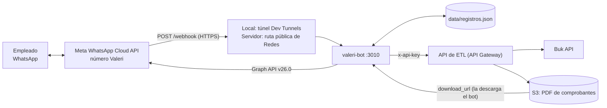
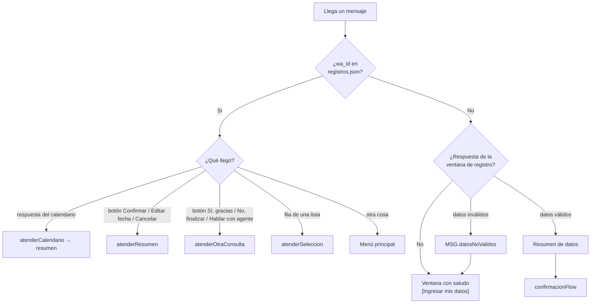
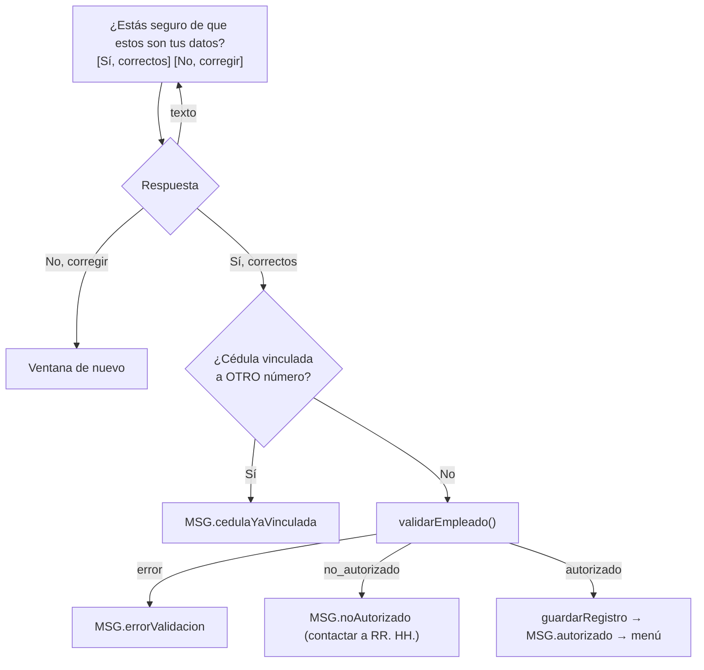
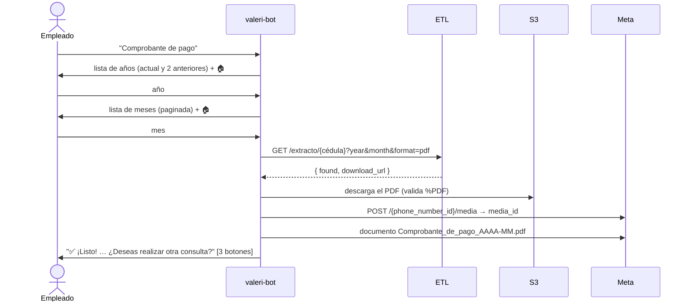
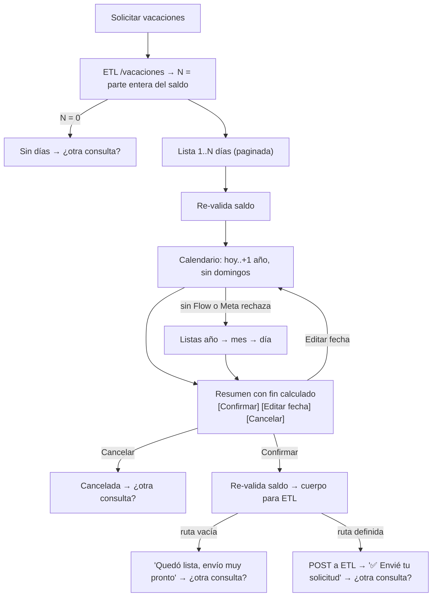

# Valeri — Documentación técnica

> **Audiencia:** desarrolladores y agentes de IA que van a operar, modificar o desplegar Valeri.
> Describe **solo el estado actual** del desarrollo: no lleva historial. Si el código contradice
> este documento, el código manda y el documento se corrige en el mismo cambio.
>
> Plataforma del servidor (común a Paula y Valeri): `00-SERVIDOR-E-INFRAESTRUCTURA.md`,
> `01-GUIA-NUEVO-AGENTE.md`, `02-ARQUITECTURA-REFERENCIA-PAULA.md`.
> Guía no técnica para el empleado: `GUIA_USUARIO.md`.

---

## Índice

1. Qué es Valeri y estado
2. Decisiones de arquitectura
3. Componentes y arquitectura
4. Identificadores de Meta
5. Variables de entorno
6. Estructura del código
7. Lógica de conversación
8. Ventanas de WhatsApp Flow (registro y calendario)
9. Validación del empleado
10. Menú y reglas comunes de navegación
11. Catálogo de mensajes
12. Datos y persistencia
13. API de ETL (lo que consume el bot)
14. Opciones del menú en detalle
15. Endpoints de Buk (referencia para ETL)
16. Operación y despliegue
17. Pendientes
18. Hablar con agente (agente de IA de AWS)

---

## 1. Qué es Valeri y estado

Valeri es la asistente de WhatsApp de **Transportes Vigía** para conductores y personal administrativo. Antes de usar el menú, cada número pasa **una sola vez** por un registro de identidad.

| Pieza | Estado |
|---|---|
| Webhook de Meta (local, por túnel) | Funciona |
| Registro con ventana (Flow) + confirmación con botones | Funciona |
| Validación del empleado | Modo **`bd` activo**: cédula y celular deben coincidir con la tabla `users` (5.870 empleados cargados del CSV temporal). Modos `abierta` (pruebas) y `etl` disponibles |
| Regla "un empleado, un número" | Funciona (base de datos: `contacts.user_id` único) |
| Sesiones y conversación | Funciona: todo entrante y saliente en `messages`; sesión cerrada a los 10 min sin actividad (con aviso al empleado) o con "No, finalizar" |
| Menú principal y "¿Deseas realizar otra consulta?" | Funciona |
| Comprobante de pago (año → mes → PDF) | Conectado a ETL `/extracto` |
| Días de vacaciones | Conectado a ETL `/vacaciones` |
| Solicitar vacaciones (días → calendario → resumen → confirmar → respuesta de Buk) | **Activo**: registra en Buk vía ETL `POST /vacaciones`. Falta la primera prueba real |
| Certificado laboral (PDF sin salario) | Conectado a ETL `POST /certificado-laboral` |
| Hablar con agente | **Desarrollado** (agente de IA de AWS, §18). Cerrado para los colaboradores hasta que exista el control de identidad en AWS (tabla DynamoDB); abierto solo para números de prueba |
| Base de datos `valeri_bot` (Prisma) y despliegue con PM2 | Funcionan en el servidor (procesos `valeri-bot` y `valeri-tunnel`) |
| Código SMS | No desarrollado |

Fase: **desarrollo local**. Reparto: ETL construye los endpoints hacia Buk; el bot hace la conversación; Infraestructura y Redes, el servidor y la ruta pública.

---

## 2. Decisiones de arquitectura

| # | Decisión | Motivo |
|---|---|---|
| D1 | Servidor interno Windows (ver `00-SERVIDOR…`), sin nube ni Docker, supervisado por PM2 | Plataforma estándar de la empresa |
| D2 | Node.js 24 + TypeScript, ES Modules, bundle con rollup | Igual que `paula-bot` |
| D3 | BuilderBot `1.4.4` + `@builderbot/provider-meta` `1.4.4` | Framework estándar de la plataforma |
| D4 | WhatsApp Cloud API directo con Meta | Sin intermediarios |
| D5 | Puerto **3010** | 3000 (`paula-api`) y 3009 (`paula-bot`) ocupados |
| D6 | Todo con botones, listas y ventanas; solo se escribe dentro de la ventana de registro | Menos errores |
| D7 | Cédula y celular se capturan con un WhatsApp Flow | No se usa el número desde el que escribe el usuario (los usuarios `@` no lo exponen) |
| D8 | Persistencia en PostgreSQL 18 (base `valeri_bot`) con Prisma 5.22; esquema en `valeri-bot/prisma/schema.prisma` y migraciones aditivas | Mismo patrón de la plataforma (Paula) |
| D9 | Aislamiento: Valeri usa solo su app de Meta y su número | No afectar a Paula |
| D10 | Todo el contenido visible en español | Requisito del negocio |
| D11 | El bot no llama a Buk: todo pasa por la API de ETL | ETL guarda el token de Buk |
| D12 | El usuario nunca recibe URLs: los PDF se suben a Meta y se envían por `media_id` | Seguridad (patrón de Paula) |
| D13 | Webhook en producción por una **ruta pública HTTPS gestionada por Redes** hacia `servidor:3010` (mismo esquema que Paula) | Sin depender de túneles de Kiro/VS Code |

---

## 3. Componentes y arquitectura



### Endpoints HTTP del bot

| Método y ruta | Quién | Qué hace |
|---|---|---|
| `GET /webhook` | Meta (al configurar) | Responde `hub.challenge` si `hub.verify_token` = `META_VERIFY_TOKEN`; si no, 403 |
| `POST /webhook` | Meta (cada mensaje) | Recibe mensajes y estados |
| `GET /health` | Monitoreo | `200 {"status":"ok","servicio":"valeri-bot"}` |
| `POST /` | Provider (interno) | No se usa |

### Enrutamiento de Meta

- El webhook se configura en la **app Pharitech/Valeri** → WhatsApp → Configuración: URL `https://<host>/webhook`, token = `META_VERIFY_TOKEN`, campo `messages`.
- La WABA puede tener un `override_callback_uri` en `/{WABA_ID}/subscribed_apps` que **reemplaza** la URL del panel. Hoy apunta a un API Gateway (`glzi4wssdc…/Prod/webhook`) y aun así los mensajes llegan al túnel; antes de producción confirmar de quién es y dejar una sola URL activa.
- Un `POST` a `/{WABA_ID}/subscribed_apps` suscribe la app dueña del token: **nunca** usar tokens de otra app (Paula) con la WABA de Valeri.

---

## 4. Identificadores de Meta

| Dato | Valor |
|---|---|
| App | **Pharitech/Valeri** — `919835907416840` |
| Número | **+57 323 232 6150** — Phone Number ID `1344598332073548` |
| WABA | `2550144075397020` |
| Graph API | `v26.0` |
| Flow de registro | `valeri_registro_v3` — `1191643797147654` — PUBLISHED — `SIGN_UP` (cédula 5–15 dígitos). Reemplaza a `valeri_registro_v2` (`1862130361868911`, máx. 10 dígitos) |
| Flow del calendario | `valeri_vacaciones_calendario_v2` — `2152027718731540` — PUBLISHED — `APPOINTMENT_BOOKING` (bloquea domingos y festivos) |

En la cuenta de Meta de la empresa hay apps y números de otros proyectos: no usarlos con Valeri. Los tokens viven **solo** en `valeri-bot/.env` (fuera de git).

---

## 5. Variables de entorno

Archivo `valeri-bot/.env` (no versionado; plantilla `.env.example`). Se carga con `node --env-file=.env`, relativo al directorio de trabajo (PM2 debe usar `cwd: valeri-bot`).

| Variable | Obligatoria | Valor actual / ejemplo | Uso |
|---|---|---|---|
| `PORT` | No (3010) | `3010` | Puerto HTTP |
| `META_JWT_TOKEN` | Sí | `EAA…` | Token de la app Valeri. Hoy temporal; en servidor, permanente de usuario del sistema |
| `META_NUMBER_ID` | Sí | `1344598332073548` | Phone Number ID |
| `META_WABA_ID` | No | `2550144075397020` | WABA (lo usan los scripts de Flows) |
| `META_VERIFY_TOKEN` | Sí | (aleatorio) | Igual al del webhook en la app |
| `META_VERSION` | No (`v26.0`) | `v26.0` | Versión Graph |
| `META_APP_SECRET` | Recomendada | vacía | Si se define, rechaza (401) webhooks sin firma válida. **Obligatoria en producción** |
| `META_FLOW_ID` | Sí | `1862130361868911` | Flow de registro |
| `META_FLOW_DRAFT` | No (`true`) | `false` | `true` = enviar Flow en modo borrador |
| `META_FLOW_CALENDARIO_ID` | No | `2152027718731540` | Flow del calendario. Vacía = listas año → mes → día |
| `VALERI_VALIDACION` | No (`bd`) | `bd` | `bd` = tabla `users` (cédula y celular deben coincidir); `abierta` = todos autorizados (pruebas); `etl` = endpoint de ETL |
| `DATABASE_URL` | Sí | `postgresql://…@localhost:5432/valeri_bot?schema=public` | Conexión de Prisma a la base `valeri_bot` |
| `VALERI_SESION_TIMEOUT_MIN` | No (10) | `10` | Minutos sin actividad para cerrar una sesión y avisar al empleado |
| `AGENTE_ARN` | Para el agente | `arn:aws:bedrock-agentcore:…:harness/…` | Agente de IA (§18). Vacía = "en construcción" |
| `AGENTE_REGION` | No (`us-east-2`) | `us-east-2` | Región del agente y de la tabla |
| `AGENTE_TABLA_SESIONES` | No | vacía | Tabla DynamoDB del control de identidad. Vacía = agente cerrado salvo números de prueba |
| `AGENTE_PERMITIR_SIN_CONTROL` | No (`false`) | `false` | `true` abre el agente a todos sin control de identidad (no recomendado) |
| `AGENTE_NUMEROS_PRUEBA` | No | wa_id separados por coma | Pueden usar el agente aunque esté cerrado |
| `AGENTE_TIMEOUT_MS` | No (90000) | `90000` | Tiempo máximo por invocación |
| `AWS_ACCESS_KEY_ID`, `AWS_SECRET_ACCESS_KEY` | Para el agente | — | Credencial de AWS (usuario `scraper`). Solo en `.env` |
| `ETL_VALIDACION_URL` | Si modo `etl` | vacía | URL completa del endpoint de validación (§9) |
| `ETL_BASE_URL` | Sí | `https://ibs9x7piq3.execute-api.us-east-2.amazonaws.com/Prod` | Base de la API de ETL |
| `ETL_TOKEN` | Sí | (API Key) | Cabecera `x-api-key` en todas las llamadas a ETL |
| `ETL_TIMEOUT_MS` | No (60000) | `60000` | Tiempo máximo por llamada y por descarga de PDF |
| `ETL_SOLICITUD_VACACIONES_RUTA` | No | `/vacaciones` (**activo**) | Ruta del POST de solicitud de vacaciones. Vacía = no se envía nada a Buk |
| `VACACIONES_TIPO` | No (`legales`) | — | Campo `type` |
| `VACACIONES_PERCENT_DAY` | No (`100`) | — | Campo `percent_day`: fracción del último día (día completo). Buk se contradice: texto "0 < x ≤ 1" y ejemplo "100" (§14.3) |
| `VACACIONES_WORKDAY_STAGE` | No (`full_working_day`) | — | Campo `workday_stage` |
| `TLS_EXTRA_CA`, `NODE_EXTRA_CA_CERTS` | **Sí en el servidor** | `./certs/acronis-ca.pem` | CA del proxy corporativo Acronis, exportada del almacén raíz de Windows. Sin ella Node falla con `fetch failed` hacia Meta y ETL. PM2 además pasa la ruta absoluta en `NODE_EXTRA_CA_CERTS` |

---

## 6. Estructura del código

```text
valeri-bot/
  package.json, rollup.config.js, tsconfig.json, .env.example
  meta/
    registro.flow.json      # ventana de registro (copia local del Flow)
    calendario.flow.json    # calendario de fecha de inicio (copia local del Flow)
  prisma/
    schema.prisma           # modelo de datos (users, contacts, sessions, messages, auth_attempts, audit_events)
    migrations/             # migraciones SQL aditivas (prisma migrate deploy)
  scripts/
    importar-usuarios.mjs   # carga el CSV temporal a la tabla users (idempotente)
  data/base_auten_tempo.csv # base temporal de empleados autorizados (fuera de git: datos personales)
  certs/acronis-ca.pem      # CA del proxy corporativo (fuera de git)
  src/
    app.ts                  # arranque, /health, manejo global de errores
    tls-setup.ts            # añade la CA corporativa (se importa de primero)
    config.ts               # lectura y validación de variables de entorno
    mensajes.ts             # TODOS los textos y títulos de botones
    validadores.ts          # normalización de cédula/celular, esBoton
    formulario.ts           # Flows: registro y calendario (envío y lectura)
    menu.ts                 # menú, listas, botones, paginación, comprobante (años/meses)
    opciones.ts             # atiende cada selección y orquesta las llamadas a ETL
    solicitud.ts            # solicitar vacaciones: días, listas de fecha (respaldo), resumen, solicitud en curso
    fechas.ts               # ventana de inicio, domingos, fecha fin, formatos
    etl.ts                  # cliente de ETL (x-api-key) + descarga de PDF + cuerpo de la solicitud
    media.ts                # sube PDF a Meta y lo envía por media_id
    validacion.ts           # validación del empleado (bd / abierta / etl)
    db.ts                   # cliente Prisma (singleton) de valeri_bot
    registros.ts            # vínculo número de WhatsApp <-> empleado (tablas contacts + users)
    sesiones.ts             # sesiones, histórico de mensajes, intentos de validación y auditoría
    flows/
      bienvenida.flow.ts    # entrada de todo mensaje (EVENTS.WELCOME)
      registro.flow.ts      # confirmación con botones + validación
```

| Archivo | Funciones principales |
|---|---|
| `formulario.ts` | `enviarFormulario`, `leerFormulario`, `enviarCalendario`, `leerCalendario` |
| `menu.ts` | `OPCIONES_MENU`, `enviarMenu`, `enviarLista`, `enviarBotones`, `enviarOtraConsulta`, `paginarFilas`, `filaVolverMenu`, `enviarAnios`, `enviarMeses`, `filasMeses`, `leerIdComprobante` |
| `opciones.ts` | `atenderSeleccion`, `esSeleccionConocida`, `leerOtraConsulta`, `atenderOtraConsulta`, `atenderCalendario`, `atenderResumen` |
| `solicitud.ts` | `enviarDias`, `filasDias`, `diasSolicitables`, `leerIdSolicitud`, `leerIdInicio`, listas de año/mes/día, `enviarResumen`, `leerBotonResumen`, `guardarEnCurso` / `obtenerEnCurso` / `borrarEnCurso` |
| `fechas.ts` | `ventanaInicio`, `inicioPermitido`, `aniosInicio`, `mesesInicio`, `diasInicio`, `fechaFin`, `siguienteHabil`, `fechaIso`, `leerFechaIso`, `fechaLarga` |
| `etl.ts` | `llamarEtl` (GET/POST), `obtenerComprobante`, `obtenerVacaciones`, `descargarPdf`, `armarSolicitudVacaciones`, `crearSolicitudVacaciones`, `solicitudVacacionesHabilitada`, `fechaEtl` |
| `media.ts` | `subirPdf`, `enviarPdf` |
| `registros.ts` | `obtenerRegistro`, `buscarNumeroPorCedula`, `guardarRegistro` (asíncronas, sobre la base) |
| `sesiones.ts` | `registrarEntrante`, `registrarSaliente`, `finalizarSesion`, `registrarIntento`, `iniciarBarridoSesiones` (escrituras encadenadas por número; un fallo de la base nunca corta la conversación) |

**Patrón de BuilderBot:** no encadenar `addAction` esperando respuestas (no esperan). Toda respuesta de lista, botón o ventana llega como **mensaje nuevo** y la atiende `bienvenidaFlow`; solo la confirmación del registro usa `addAnswer` con `capture`.

**El provider no entrega el id del botón tocado**, solo su título (`ctx.title_button_reply`). Por eso los botones se reconocen por título con `esBoton` (sin tildes ni mayúsculas) y todos los títulos del bot deben ser distintos entre sí. Los mensajes con botones se arman a mano (`enviarBotones`) porque `provider.sendButtons` recorta los títulos a 16 caracteres; el límite de Meta es 20.

---

## 7. Lógica de conversación

### 7.1 Entrada de todo mensaje (`bienvenidaFlow`)



### 7.2 Confirmación y validación (`confirmacionFlow`)



Si el estado (cédula y celular) se perdió por un reinicio, se vuelve a enviar la ventana.

### 7.3 Estado

- `MemoryDB` (memoria): cédula y celular entre la ventana y la confirmación.
- `solicitud.ts`: solicitud de vacaciones en curso por wa_id (30 minutos de vigencia).
- `data/registros.json`: lo permanente (quién está autorizado).
- Los ids de las listas llevan el contexto necesario (año, mes, días), así que las listas no dependen de memoria.

---

## 8. Ventanas de WhatsApp Flow

Las ventanas viven en Meta; los archivos de `meta/` son la copia local. **Un Flow publicado no se puede editar.** Para cambiar uno:

1. Editar el JSON (etiquetas ≤ 20 caracteres).
2. `POST https://graph.facebook.com/v26.0/{META_WABA_ID}/flows` (multipart: `name` nuevo, `categories`, `flow_json`, `publish=true`), con `Authorization: Bearer <META_JWT_TOKEN>`. Debe responder `success: true` y `validation_errors: []`.
3. Poner el id devuelto en la variable del `.env` (`META_FLOW_ID` o `META_FLOW_CALENDARIO_ID`), reiniciar el bot y actualizar §4.

Los mensajes que **abren** las ventanas se arman a mano con `provider.sendMessageMeta` (`provider.sendFlow` siempre envía `flow_action_payload.data`, y Meta rechaza un objeto vacío con el error 131009). Sus textos están en `mensajes.ts`.

### 8.1 Registro (`meta/registro.flow.json`)

Flow JSON 7.2, pantalla `REGISTRO`, sin endpoint. Mensaje: encabezado "¡Hola! Soy Valeri 👋", botón "Ingresar mis datos", `flow_action_payload: { screen: "REGISTRO" }` (sin `data`).

| name | label | input-type | Reglas | Ayuda |
|---|---|---|---|---|
| `cedula` | Número de cédula | `number` | obligatorio, 5–15 | Solo números, sin puntos ni espacios |
| `telefono` | Número celular | `phone` | obligatorio | El registrado en la empresa. Ej: 3001234567 |

"Continuar" (`complete`) devuelve `{cedula, telefono}` en `ctx.nfm_reply`. El bot normaliza (`validadores.ts`): cédula solo dígitos (5–15, sin ceros a la izquierda; acepta puntos, espacios y "CC"); celular de 10 dígitos (acepta `+57`, `57`, `0057`, espacios, guiones y paréntesis). No se exige que empiece por 3: la validación real es que coincida con el registrado en `users`.

### 8.2 Calendario de fecha de inicio (`meta/calendario.flow.json`)

Flow JSON 7.2, pantalla `FECHA_INICIO`, componente **CalendarPicker** (`mode: single`, `include-days: Mon..Sat` → domingos bloqueados, `unavailable-dates: ${data.festivos}` → festivos bloqueados, `required`).

| Envío (`enviarCalendario`) | Valor |
|---|---|
| Botón | "Elegir fecha" |
| `flow_action_payload.data` | `dias`, `texto`, `min_fecha` = hoy, `max_fecha` = hoy + 1 año, `festivos` = festivos de Colombia en esa ventana (`YYYY-MM-DD`, `festivosEntre`) |
| Respuesta (`ctx.nfm_reply`) | `{ tipo: "vacaciones_inicio", fecha: "YYYY-MM-DD", dias: "N" }` |

- `leerCalendario` reconoce la respuesta por `tipo` y acepta la fecha en `YYYY-MM-DD` o en milisegundos.
- El bot **vuelve a validar** la fecha (`inicioPermitido`). Si no sirve, envía `MSG.calendario.fechaNoValida` y el calendario otra vez.
- Si `META_FLOW_CALENDARIO_ID` está vacía o Meta rechaza el envío, se usan las listas año → mes → día (§14.3).

---

## 9. Validación del empleado (`validacion.ts`)

| `VALERI_VALIDACION` | Comportamiento |
|---|---|
| `bd` | **Activo.** Busca la cédula en `users`: autorizado solo si existe, está activa y el celular registrado es **igual** al ingresado. Si no, `MSG.noAutorizado` (mismo mensaje en todos los casos, para no revelar qué dato falló): no está registrado, no puede usar los servicios, debe actualizar sus datos en Buk y comunicarse con Gestión Humana |
| `abierta` | Siempre `autorizado` (pruebas). Al arrancar, el log muestra **MODO PRUEBAS** |
| `etl` | Consulta `ETL_VALIDACION_URL` |

Cada intento queda en `auth_attempts` (`AUTORIZADO`, `NO_REGISTRADO`, `CEDULA_EN_OTRO_NUMERO`, `ERROR`).

Cargar o actualizar la base de empleados (idempotente, no borra a nadie, no imprime datos personales):

```powershell
cd valeri-bot
npm.cmd run db:importar-usuarios            # data/base_auten_tempo.csv
npm.cmd run db:importar-usuarios -- otra.csv
```

Contrato **provisional** (confirmar con ETL antes de activar):

```
GET {ETL_VALIDACION_URL}?cedula=1023456789&telefono=3001234567
x-api-key: {ETL_TOKEN}          Tiempo máximo: 15 s

200 { "autorizado": true,  "id_buk": 1234 }
200 { "autorizado": false, "motivo": "no_encontrado" | "inactivo" | "telefono_no_coincide" }
```

| Respuesta | Resultado | Mensaje |
|---|---|---|
| `autorizado: true` | autorizado | `MSG.autorizado` + menú |
| `autorizado: false` | no autorizado | `MSG.noAutorizado` |
| Sin `autorizado`, no 2xx, sin URL, sin conexión | error | `MSG.errorValidacion` |

Lógica esperada en ETL: `GET /employees/{cédula}` de Buk; autorizado si `status = "activo"` y el teléfono registrado coincide.

**Un empleado, un número:** antes de validar, si la cédula ya está vinculada a **otro** wa_id → `MSG.cedulaYaVinculada`. Para liberar un vínculo (cambio de celular): `UPDATE contacts SET user_id = NULL, verified_at = NULL WHERE wa_id = '<número anterior>';`

---

## 10. Menú y reglas comunes de navegación

### 10.1 Menú principal (lista)

Encabezado "📋 Menú principal", cuerpo "¿En qué te puedo ayudar hoy? 😊", botón "Ver opciones", pie "Transportes Vigía". Se muestra sin saludo: tras validarse y cada vez que un usuario autorizado escribe algo que no es una respuesta.

| id | Título | Atención |
|---|---|---|
| `comprobante` | Comprobante de pago | §14.1 |
| `dias_vacaciones` | Días de vacaciones | §14.2 |
| `solicitar_vacaciones` | Solicitar vacaciones | §14.3 |
| `certificado` | Certificado laboral | §14.4 |
| `agente` | Hablar con agente | Agente de IA (§18). No hay atención humana: es solo el agente. "En construcción" mientras esté cerrado |

Límites de Meta en listas: encabezado 60, cuerpo 1024, botón 20, título de fila 24, descripción 72, **máximo 10 filas**.

### 10.2 Regla: "🏠 Menú principal" al final de toda lista secundaria

Toda lista que no sea el menú termina con la fila `volver_menu` ("🏠 Menú principal" / "Volver al inicio", `filaVolverMenu()`), que **cuenta dentro de las 10 filas**. Al tocarla se muestra el menú.

### 10.3 Regla: paginación (`paginarFilas`)

- 9 filas o menos: una sola página + 🏠.
- Más: página 1 = 8 filas + "Más… ➡️" + 🏠; intermedias = "⬅️ …" + 7 + "Más… ➡️" + 🏠; última = "⬅️ …" + hasta 8 + 🏠.

Así ninguna lista pasa de 10 filas. Las listas de días de vacaciones y de la fecha usan esta regla; la de meses del comprobante usa la misma forma con 2 páginas.

### 10.4 Regla: todo proceso termina con "¿Deseas realizar otra consulta?"

Ningún proceso vuelve directo al menú. Al terminar se envía `enviarOtraConsulta` con 3 botones:

| Botón | Qué hace |
|---|---|
| Sí, gracias | Menú principal |
| No, finalizar | `MSG.despedida` y `state.clear()`; no envía menú. El registro se conserva |
| Hablar con agente | Igual que la opción `agente` |

Cuerpo: con archivo entregado, "✅ ¡Listo! <texto>\n\n¿Deseas realizar otra consulta?"; en los demás casos, "¿Deseas realizar otra consulta? 😊". Toda opción nueva debe terminar con `enviarOtraConsulta(...)` y devolver `'nada'`.

---

## 11. Catálogo de mensajes (`mensajes.ts`)

| Clave | Uso |
|---|---|
| `MSG.formulario` | Saludo y botón de la ventana de registro |
| `MSG.datosNoValidos`, `MSG.resumenDatos`, `MSG.preguntaConfirmacion`, `MSG.usaLosBotones`, `MSG.corregirDatos` | Registro y confirmación |
| `MSG.autorizado`, `MSG.noAutorizado`, `MSG.cedulaYaVinculada`, `MSG.errorValidacion` | Resultado de la validación |
| `MSG.menu`, `MSG.volverMenu` | Menú y fila 🏠 |
| `MSG.otraConsulta`, `MSG.despedida`, `BOTONES_OTRA_CONSULTA` | Cierre de procesos |
| `MSG.opcionEnConstruccion`, `MSG.errorConsulta` | Opción no disponible; falla técnica con ETL o Meta |
| `MSG.comprobante.*` | Listas de año y mes, espera, texto del PDF, no encontrado |
| `MSG.vacaciones.*` | Espera y "Tienes *N días*…" |
| `MSG.certificado.*` | Espera, texto del PDF, entregado, datos incompletos (422), no encontrado (404) |
| `MSG.solicitud.*` | Lista de días, listas de fecha, resumen, enviada / sin envío / cancelada / vencida / sin días / excede saldo |
| `MSG.calendario.*` | Mensaje del calendario, texto interno, fecha no válida |
| `MSG.botonesSolicitud` | Confirmar, Editar fecha, Cancelar |

`BOTONES` (registro): "Sí, correctos" / "No, corregir".

---

## 12. Datos y persistencia

PostgreSQL 18 del servidor, base **`valeri_bot`**, acceso con **Prisma 5.22**. Esquema: `valeri-bot/prisma/schema.prisma`. Migraciones en `prisma/migrations/` (`20261120120000_init`, `20261121090000_json_contacts`, `20261124090000_sessions_agent_mode`, `20261125090000_autentication`), aplicadas con `npm.cmd run db:migrate` (`prisma migrate deploy`). Horas en UTC (`timestamptz`).

### 12.1 Tablas

| Tabla | Qué guarda | Claves |
|---|---|---|
| `users` | Empleados autorizados (base de validación). Hoy: CSV temporal (`source = CSV_TEMPORAL`) | `document` único; `phone` (10 dígitos); `active` |
| `contacts` | Cada número de WhatsApp que escribe. `verified_at` con fecha = autorizado | PK `wa_id`; `user_id` **único** (un empleado, un número); `phone_declared`, `id_buk` |
| `sessions` | Conversaciones | `status` `ACTIVE`/`CLOSED`; `close_reason` `USER_FINISHED`/`TIMEOUT`/`SYSTEM`; `last_activity_at`, `message_count` |
| `messages` | Histórico completo (entrantes y salientes) | `direction` `INBOUND`/`OUTBOUND`; `type`; `content` legible; `payload` JSON (fila elegida, botón, respuesta de la ventana, opciones enviadas, error de Meta); `external_message_id` |
| `auth_attempts` | Cada intento de validación (cédula y celular ingresados + resultado) | `result` `AUTORIZADO`/`NO_REGISTRADO`/`CEDULA_EN_OTRO_NUMERO`/`ERROR` |
| `audit_events` | Eventos de dominio: `SESSION_OPENED`, `SESSION_CLOSED`, `AUTH_ATTEMPT` | `event_type`, `wa_id`, `session_id`, `detail` |
| `json` | Fragmento `contacts` del webhook crudo de Meta, tal cual llega, **cada vez que alguien escribe** (no se guardan los avisos de entregado/leído). Una sola columna | `contacts` `jsonb`: `{"contacts":[{"profile":{"name","username"},"wa_id","user_id","country_code"}]}`. Modelo `@@ignore` en Prisma (sin identificador); se inserta con SQL directo (`guardarJsonContacts`). Migración `20261121090000_json_contacts` |
| `autentication` | **Prevista, aún sin uso en el código.** Traza de la autenticación por código: el usuario escribe cédula y teléfono, una API envía por WhatsApp un código y el usuario lo digita. Cada intento queda registrado | `document`, `phone`, `code` (texto, conserva ceros), `status` (`1` aprobado, `0` no pasó; por defecto 0), `created_at`. Índices por cédula, teléfono y fecha. Migración `20261125090000_autentication`. Al implementarla: regenerar el cliente Prisma, vencimiento corto del código y límite de intentos |

**Usuarios de la base:** `desarrollo` (dueño, usa el bot y las migraciones) y `consulta` (**solo lectura**: `CONNECT`, `USAGE` en `public` y `SELECT` en todas las tablas, incluidas las futuras creadas por `desarrollo`). Ojo: `consulta` puede ver cédulas, teléfonos y mensajes.

### 12.2 Cómo se registra la conversación

- Entrantes: el provider emite `message` por cada mensaje; `app.ts` lo guarda.
- Salientes: todos los envíos del provider (texto, listas, botones, ventanas, PDF) pasan por `provider.sendMessageMeta`; `app.ts` lo envuelve y guarda cada envío (incluido el error de Meta, si lo hubo).
- Sesión (igual que Paula): un barrido cada 60 s cierra (`TIMEOUT`) las sesiones sin actividad durante `VALERI_SESION_TIMEOUT_MIN` (**10 min**) y le envía al empleado `MSG.sesionCerrada` ("Tu sesión ha sido finalizada por inactividad…"). Al cerrar se descarta lo que quedó a medias: la solicitud de vacaciones en curso y los datos del registro sin confirmar. "No, finalizar" la cierra (`USER_FINISHED`, sin aviso extra: ya se envió la despedida).
- Al volver a escribir se abre una sesión nueva. El registro es permanente (`contacts` + `users`): un empleado ya validado va **directo al menú**; uno no registrado recibe de nuevo la ventana de registro (incluso si había dejado los datos sin confirmar).
- Los mensajes salientes nunca abren sesión: el aviso de cierre queda en la sesión que se cerró.
- Un fallo de la base se registra en el log y **no** interrumpe la conversación.

### 12.3 Operación frecuente (SQL)

```sql
-- Repetir el registro desde un número (o liberar el vínculo por cambio de celular)
UPDATE contacts SET user_id = NULL, verified_at = NULL WHERE wa_id = '573001234567';

-- Desactivar a un empleado (no podrá validarse; se conserva el histórico)
UPDATE users SET active = false WHERE document = '1023456789';

-- Conversación de un número
SELECT m.created_at, m.direction, m.type, m.content
FROM messages m WHERE m.wa_id = '573001234567' ORDER BY m.created_at;

-- Intentos de validación fallidos del día
SELECT wa_id, document, result, detail, created_at FROM auth_attempts
WHERE result <> 'AUTORIZADO' AND created_at >= current_date ORDER BY created_at DESC;
```

---

## 13. API de ETL (lo que consume el bot)

| Dato | Valor |
|---|---|
| Swagger | `http://etl-integracion.s3-website.us-east-2.amazonaws.com/swagger/tv-prd-services-buk/` (OpenAPI 3.0.3, `services_buk (TV)` 1.1.0) |
| Base | `ETL_BASE_URL` |
| Autenticación | `x-api-key: <ETL_TOKEN>` (sin ella → 403) |

Todo pasa por `etl.ts → llamarEtl`: arma la URL (base + ruta), agrega la API Key, aplica `ETL_TIMEOUT_MS`, usa GET o POST con JSON, y nunca lanza excepciones:

| Caso | Resultado |
|---|---|
| Falta `ETL_BASE_URL` o `ETL_TOKEN` | `{ ok:false, estado:0 }` sin llamar |
| HTTP no 2xx | `{ ok:false, estado, detalle }` |
| Red caída / tiempo agotado | `{ ok:false, estado:0 }` |
| 2xx | `{ ok:true, datos }` |

| Endpoint ETL | Función | Opción | Estado |
|---|---|---|---|
| `GET /extracto/{cedula}?year&month&format=pdf` | `obtenerComprobante` | Comprobante de pago | Conectado |
| `GET /vacaciones/{cedula}?date=DD-MM-YYYY` | `obtenerVacaciones` | Días de vacaciones, Solicitar vacaciones | Conectado |
| `POST /vacaciones` (`ETL_SOLICITUD_VACACIONES_RUTA`) | `crearSolicitudVacaciones` | Solicitar vacaciones | Publicado por ETL (Swagger 1.3.0). Apagado en el bot hasta definir la variable |
| `GET {ETL_VALIDACION_URL}` | `validarEmpleado` | Registro | Pendiente de ETL |
| `POST /certificado-laboral` `{cedula}` | `obtenerCertificado` | Certificado laboral | Conectado (Swagger 1.5.0) |

Ambos endpoints conectados se consultan por **cédula** (el Swagger dice `employee_id` en `/vacaciones`, pero ETL confirmó la cédula). Los logs nunca incluyen cédula, teléfono ni API Key; el número aparece enmascarado (`******1234`).

---

## 14. Opciones del menú en detalle

### 14.1 Comprobante de pago



| Lista | Regla | Ids |
|---|---|---|
| Años | Actual y 2 anteriores + 🏠 | `anio_AAAA` |
| Meses | Del más reciente al más antiguo; en el año actual hasta el mes actual. ≤ 9 meses: todos + 🏠. Más: página 1 = 8 + "Más meses ➡️" + 🏠; página 2 = resto + "⬅️ Meses recientes" + 🏠 | `mes_AAAA_M`, `meses_AAAA_N` |

| Respuesta de ETL | Qué hace el bot |
|---|---|
| 200 `found: true` | Descarga, sube a Meta y envía el PDF ("📄 Tu comprobante de pago de *Mes AAAA*.") |
| 200 `found: false`, sin URL o 404 | `MSG.comprobante.noEncontrado` |
| Otro error, falla de descarga o de Meta | `MSG.errorConsulta` |

Siempre termina con "¿otra consulta?". La `download_url` vence en 60 minutos y el usuario nunca la ve. Un año o mes fuera de rango vuelve a mostrar la lista correspondiente.

### 14.2 Días de vacaciones

`GET /vacaciones/{cedula}?date=<hoy DD-MM-YYYY>` → `{ vacations: [{ name, stock }] }`. Se suma `stock` de todos los tipos y se muestra "🌴 Tienes *N días* de vacaciones pendientes por disfrutar." (formato es-CO, máx. 2 decimales). Error → `MSG.errorConsulta`. Termina con "¿otra consulta?".

### 14.3 Solicitar vacaciones

**Regla:** nunca se puede pedir más días de los disponibles.



**Paso 1 — días** (`solicitud.ts → enviarDias`): N = parte entera de la suma de `stock` (10,5 → 10). Lista "1 día", "2 días"… paginada (§10.3). Ids `vac_dias_{n}` y `vac_pag_{inicio}_{max}`. Al elegir, se vuelve a consultar el saldo; si ya no alcanza → `MSG.solicitud.excedeSaldo` y la lista con el saldo actual.

**Paso 2 — fecha de inicio:** calendario (§8.2). Respaldo con listas:

| Regla | Detalle |
|---|---|
| Ventana | Desde hoy hasta hoy + 1 año (`VENTANA_MESES = 12`) |
| Día hábil (`esHabil`) | Lunes a sábado que no sea festivo. Es lo que Buk cuenta como `working_days` |
| Domingos y festivos | No se pueden elegir como inicio y no se cuentan |
| Festivos (`festivosColombia`) | Calculados por año (Ley 51 de 1983): fijos (1-ene, 1-may, 20-jul, 7-ago, 8-dic, 25-dic); trasladados al lunes (Reyes, San José, San Pedro, Asunción, Raza, Todos los Santos, Cartagena); según la Pascua (Jueves y Viernes Santo, Ascensión +43, Corpus +64, Sagrado Corazón +71). Verificados contra el calendario oficial 2026 y 2027 (18 y 18) |
| Ids de las listas | `vi_a_{n}_{AAAA}`, `vi_mp_{n}_{AAAA}_{p}`, `vi_m_{n}_{AAAA}_{M}`, `vi_dp_{n}_{AAAA}_{M}_{p}`, `vi_d_{n}_{AAAA}_{M}_{D}` |
| Fecha inválida | Vuelve a la lista de años |

**Paso 3 — resumen** (`enviarResumen`):
El empleado solo elige **cuántos días** y la **fecha de inicio**; el bot calcula el resto con las mismas reglas que Buk:

- **Fin** (`fechaFin`): día en que se completan N días hábiles contando el inicio como el primero; domingos y festivos se saltan. Ej.: jueves 12-nov-2026 + 4 → jue 12, vie 13, sáb 14, (dom 15, lun 16 festivo), mar 17 → **fin martes 17**.
- **Días calendario** (`diasCalendario`): todos los días de inicio a fin, ambos incluidos (en el ejemplo, 6). Es lo que Buk llama `calendar_days`.
- **Regreso** (`siguienteHabil`): siguiente día hábil después del fin.
- **Antes de confirmar** el resumen muestra **solo** los días hábiles a solicitar y la fecha de inicio, con [Confirmar] [Editar fecha] [Cancelar]. Fin, días calendario y regreso se calculan (el POST necesita `end_date` y luego se comparan con Buk) pero **no se muestran**: se muestran después, con los datos que devuelve Buk. **Hasta tocar Confirmar no se llama a ninguna API de escritura.**
- La solicitud queda en memoria por wa_id (30 min); si venció → `MSG.solicitud.vencida`.
- Garantía comprobada: para 400 fechas de inicio × 5 cantidades, los días hábiles entre inicio y fin son exactamente N y el fin siempre es hábil.

**Paso 4 — confirmar:** se vuelve a consultar el saldo y se arma el cuerpo (`armarSolicitudVacaciones`), con el mismo modelo que Buk `POST /vacations`:

```json
{
  "employee_id": 1234567,
  "type": "legales",
  "start_date": "2026-11-12",
  "end_date": "2026-11-16",
  "percent_day": 100,
  "workday_stage": "full_working_day"
}
```

| Campo | Origen |
|---|---|
| `employee_id` | La **cédula** del registro, como número. ETL la traduce al id de Buk (confirmado con una solicitud real creada con una cédula). Hay empleados para los que la API responde `404 {"errors":["No encontrado: Employee"]}` aunque existen y están activos (ver pendiente 2) |
| `type` | `VACACIONES_TIPO` (`legales`) |
| `start_date` / `end_date` | Inicio elegido / fin calculado, `YYYY-MM-DD` |
| `percent_day` | `VACACIONES_PERCENT_DAY` (`100`). Fracción del último día que es vacaciones, no la cantidad de días. El contrato de Buk se contradice (texto: "mayor a 0 y ≤ 1, 1 = completo"; esquema y ejemplo: entero `100`); el Swagger de ETL acepta hasta 100. Si Buk rechaza el 100, se verá el motivo y se cambia la variable a `1` sin tocar código |
| `workday_stage` | `VACACIONES_WORKDAY_STAGE` (`full_working_day`) |

Contrato de ETL (Swagger 1.3.0, `postVacaciones`): exige exactamente esos 6 campos (`additionalProperties: false`), `employee_id` entero ≥ 1, fechas `date`, `percent_day` > 0 y ≤ 100. Responde 200/201 con la respuesta de Buk sin cambios; 400 si faltan campos (verificado en vivo con cuerpo vacío); 401 credencial de Buk; 403 API Key; 422 Buk rechazó los datos; 500/502.

Envío: `POST {ETL_BASE_URL}{ETL_SOLICITUD_VACACIONES_RUTA}` con `x-api-key` y JSON. **Activo** (`/vacaciones`). La solicitud en curso se borra antes del envío: un segundo toque en "Confirmar" no crea otra vacación.

**Paso 5 — respuesta de Buk** (contrato de Buk `POST /vacations`, 201):

```json
{ "vacation": { "employee_id": 3993, "type": "legales", "start_date": "2026-11-12", "end_date": "2026-11-17",
                "working_days": 4, "calendar_days": 6, "workday_stage": "full_working_day" } }
```

| Resultado | Qué hace el bot |
|---|---|
| 2xx | `leerVacacionRegistrada` (acepta `vacation`, `data` o el objeto en la raíz). Envía "✅ ¡Tu solicitud de vacaciones ha sido exitosa!" (`MSG.solicitud.enviada`) con **los datos que devolvió Buk**: días hábiles (`working_days`), días calendario (`calendar_days`), inicio, fin y regreso |
| 404 | Empleado no encontrado en Buk (por ejemplo, si se envía la cédula en vez del id) → `MSG.errorConsulta` y log `[etl] solicitud de vacaciones falló … 404` |
| 2xx distinto de lo mostrado | `compararConBuk` compara días hábiles, días calendario, inicio y fin con el resumen. Si algo difiere → `MSG.solicitud.diferencia` (aviso al empleado) y log `[solicitud] … Buk registró distinto` |
| 2xx sin formato reconocible | Informa con lo calculado por el bot y deja la respuesta en el log |
| 400 / 422 | `leerMotivoRechazo` (Buk: `{errors: [...]}`; ETL: `{error}` o `{message}`) → `MSG.solicitud.rechazada(motivo)`: "Buk no aceptó tu solicitud… Motivo: …" |
| 401 / 403 / 5xx / sin respuesta | `MSG.errorConsulta` |

Siempre termina con "¿otra consulta?". Con la ruta vacía no se envía nada: `MSG.solicitud.sinEnvio` y log `[solicitud] … NO enviada` (sin cédula). 2xx → `MSG.solicitud.enviada`; error → `MSG.errorConsulta`.

---

### 14.4 Certificado laboral

```
POST {ETL_BASE_URL}/certificado-laboral
x-api-key: {ETL_TOKEN}
{ "cedula": "<cédula del registro>" }        ← único campo (texto o número; no admite otros campos)
```

ETL consulta el empleado en Buk y genera el certificado **sin salario** de Transportes Vigía (nombre, cédula, cargo, fecha de inicio y tipo de contrato; si está retirado, "desde … hasta …"). Respuesta 200, misma forma que el comprobante: `{ cedula, employee_id, full_name, status, found, filename, content_type, size_bytes, s3_key, download_url, expires_in }`. La URL vence en 60 min; ETL borra el archivo a los 7 días.

Flujo (`opciones.ts → atenderCertificado`): "⏳ Estoy generando tu certificado laboral…" → ETL → descarga `download_url` (valida `%PDF`) → sube a Meta → documento `Certificado_laboral.pdf` con "📄 Tu certificado laboral de Transportes Vigía." → "✅ ¡Listo! Tu certificado laboral se generó correctamente. ¿Deseas realizar otra consulta?". El usuario nunca ve la URL.

| Respuesta | Qué hace el bot |
|---|---|
| 200 `found: true` | Envía el PDF |
| 200 sin URL, 404 | `MSG.certificado.noEncontrado` (comunicarse con RR. HH.) |
| 422 (falta cargo, fecha de inicio, tipo de contrato o fecha de retiro en Buk) | `MSG.certificado.datosIncompletos` (RR. HH. debe completar los datos); el motivo de ETL queda en el log |
| 400 / 403 / 5xx / sin respuesta, falla de descarga o de Meta | `MSG.errorConsulta` |

Siempre termina con "¿otra consulta?". Verificado en vivo: 200, empleado activo, PDF de 90 KB descargado y válido.

## 15. Endpoints de Buk (referencia para ETL)

Base `https://transportesvigia.buk.co/api/v1/colombia`, cabecera `auth_token` (sin `Bearer`). El bot **no** llama a Buk; esto es lo que ETL usa por detrás.

| Uso | Endpoint | Acepta | Notas |
|---|---|---|---|
| Validación | `GET /employees/{x}` | cédula o id | `data.id`, `full_name`, `status` (`activo`), `current_job` |
| Comprobante | `GET /employees/{id}/statements/{year}-{month}.pdf` | id | 200 PDF; 404 = mes sin liquidar |
| Días de vacaciones | `GET /employees/{x}/vacations_available` | cédula o id | `vacations[]` con `name`, `stock`; `date=DD-MM-YYYY` |
| Días hábiles | `GET /vacations/business_days?start_date&end_date` | — | `{business_days: N}`; descuenta festivos |
| Solicitar vacaciones | `POST /vacations` | id | `employee_id`, `type`, `start_date`, `end_date`, `percent_day`, `workday_stage` |
| Solicitudes existentes | `GET /vacations/requested` | — | Paginar y filtrar por `employee_id` |
| Certificado (datos) | `GET /employees/{x}`, `GET /employees/{id}/jobs`, `GET /companies` | — | Buk no genera el certificado por API: el PDF se arma con plantilla de RR. HH. |
| Documentos | `GET /employees/{id}/docs` | id | Solo documentos ya generados en Buk |

---

## 16. Operación y despliegue

### 16.1 Local

```powershell
cd valeri-bot
npm.cmd install            # PowerShell de este equipo bloquea npm.ps1: usar npm.cmd
npm.cmd run build          # rollup -> dist/app.js
node --env-file=.env ./dist/app.js
```

Reiniciar tras un cambio: detener el proceso (`Get-CimInstance Win32_Process -Filter "Name='node.exe'" | Where-Object { $_.CommandLine -like '*dist/app.js*' } | ForEach-Object { Stop-Process -Id $_.ProcessId -Force }`), compilar si cambió `src/` y arrancar. Si quedó otro proceso, sale `EADDRINUSE :::3010`.

Túnel local: Kiro/VS Code → Ports → `3010` → visibilidad **Public**; la URL + `/webhook` va en la app Valeri. Kiro necesita `code-tunnel.exe` copiado desde `AppData\Local\Programs\Microsoft VS Code\bin\` a `AppData\Local\Programs\Kiro\bin\`.

### 16.2 Servidor (PM2)

1. Confirmar el puerto libre (`Get-NetTCPConnection -State Listen -LocalPort 3010`) y anotarlo en `00-SERVIDOR…` §5.
2. Copiar `valeri-bot/` sin `node_modules`, `dist`, `.env` ni `data`.
3. Crear `.env` con: token **permanente**, `META_APP_SECRET`, `VALERI_VALIDACION=etl`, `ETL_VALIDACION_URL` y las variables de ETL.
4. Si hay inspección SSL: CA en `certs/` y `TLS_EXTRA_CA` / `NODE_EXTRA_CA_CERTS`.
5. `npm install`, `npm run build`, prueba manual y `GET /health`.
6. Agregar a `deploy/ecosystem.config.cjs`:
   ```js
   { name: 'valeri-bot', script: 'dist/app.js', cwd: join(root, 'valeri-bot'),
     interpreter: 'node', interpreter_args: '--env-file=.env', instances: 1,
     exec_mode: 'fork', autorestart: true, max_memory_restart: '512M',
     env: { NODE_ENV: 'production' } }
   ```
7. `pm2 start deploy/ecosystem.config.cjs` → `pm2 save`. Reiniciar después: `pm2 restart valeri-bot --update-env`.
8. Firewall (Administrador): `New-NetFirewallRule -DisplayName "Valeri Bot 3010" -Direction Inbound -Protocol TCP -LocalPort 3010 -Action Allow`.
9. Redes publica `https://<subdominio>/webhook` → `servidor:3010` con certificado **público** (Meta no acepta la CA interna `vigia`). Configurar esa URL en la app Valeri y revisar el override de la WABA (§3).

### 16.2b Webhook público en el servidor (Microsoft Dev Tunnels)

Mientras Redes no publique una ruta propia, el webhook se expone con un **Dev Tunnel persistente** que no depende de Kiro ni de VS Code:

- El ejecutable `devtunnel.exe` (firmado por Microsoft) y la configuración de PM2 viven en `infra/`, que está **fuera de git** porque contiene el ID del túnel. El detalle operativo está en `infra/LEEME.md`, solo en el servidor.
- El túnel tiene un ID aleatorio, expone solo el puerto `3010` y tiene acceso anónimo (Meta no se autentica). Solo hace conexiones de **salida**: no abre puertos ni requiere administrador.
- PM2 lo mantiene vivo con el proceso `valeri-tunnel`. `valeri-tunnel-renovar` extiende cada semana la vida del túnel, que es de 30 días deslizantes.
- Con la URL pública activa, `META_APP_SECRET` es **obligatoria**.
- Dev Tunnels es una herramienta de desarrollo. Para producción a largo plazo, migrar a Cloudflare Tunnel o a la ruta de Redes (D13); el bot no cambia.

### 16.3 Problemas conocidos

| Síntoma | Causa | Solución |
|---|---|---|
| No llegan mensajes | Override de la WABA o túnel/ruta caída | §3; `GET /health` por la URL pública |
| `403 Invalid token!` al verificar | `META_VERIFY_TOKEN` distinto o sin reiniciar | Igualar y reiniciar |
| `EADDRINUSE :::3010` | Otro proceso escuchando | Detenerlo (§16.1) |
| `(#131009) … dynamic_object` | `flow_action_payload.data` vacío | No enviar `data` vacío |
| "label must be 20 characters or less" | Etiqueta de Flow larga | ≤ 20 caracteres |
| Texto en inglés "Hello! This is a test message" | Flow en borrador | Publicarlo y `META_FLOW_DRAFT=false` |
| El bot deja de enviar | Token temporal vencido | Token nuevo o permanente |
| Cambié un `meta/*.flow.json` y no cambia la ventana | El archivo es solo la copia local | §8 |
| Log `[etl] … estado 403` / `estado 0 … no está definido` | API Key inválida o ausente | Revisar `ETL_TOKEN` |
| Log `[etl] descarga del comprobante falló` | URL de S3 vencida o no es PDF | Reintentar; revisar con ETL |
| "Esa solicitud ya no está activa" | Pasaron 30 min o se reinició el bot | Empezar de nuevo desde el menú |
| Respuestas duplicadas | Meta reintenta el webhook | Pendiente: idempotencia |
| `.env: not found` | Se ejecutó fuera de `valeri-bot` | Ejecutar con cwd en `valeri-bot` |

---

## 17. Pendientes

| # | Tema | Responsable |
|---|---|---|
| 1 | Endpoint de validación (contrato §9) y activar `VALERI_VALIDACION=etl` | ETL + Bot |
| 2 | **`POST /vacaciones` responde `404 "No encontrado: Employee"` para un empleado activo** que sí encuentran `GET /vacaciones/{cédula}` (saldo) y `POST /certificado-laboral` (certificado generado). Falla con su cédula y con su id de Buk; con otra cédula la creación sí funcionó. Revisar en ETL / Buk qué tiene distinto ese empleado (por ejemplo, su política de vacaciones). Después, confirmar con la primera respuesta real que `working_days` y `calendar_days` coinciden con lo calculado | ETL + RR. HH. + Bot |
| 3 | El cuerpo de Buk se llama `approved_vacation`: confirmar si la vacación queda **aprobada directamente** o pendiente de RR. HH. | ETL + RR. HH. |
| 4 | Evitar cruces con solicitudes existentes (`GET /vacations/requested`) | ETL + Bot |
| 6 | "Hablar con agente": a dónde se transfiere | Negocio |
| 7 | Prueba completa por WhatsApp de las tres opciones conectadas | Bot |
| 8 | Token permanente y `META_APP_SECRET` | Meta / TI |
| 9 | Ruta pública de Redes, despliegue con PM2 y override de la WABA | Infraestructura + Redes |
| 10 | Idempotencia por `message_id` (Meta puede reenviar un webhook). La base `valeri_bot` ya está en uso | Bot |
| 13 | Reemplazar el CSV temporal por la validación contra Buk (modo `etl`) cuando ETL publique el endpoint; la tabla `users` puede seguir como respaldo | ETL + Bot |
| 11 | Código de verificación por WhatsApp: la tabla `autentication` ya existe (§12.1); falta la API y el flujo. Diseño completo en `docs/AUTENTICACION.md` | Bot |
| 14 | Tabla DynamoDB `valeri-sesiones` y usuario IAM dedicado en lugar de `scraper` (§18.4) | AWS / TI |
| 12 | Proceso para liberar el vínculo cuando un empleado cambia de celular | RR. HH. / TI |

---

## 18. Hablar con agente (agente de IA de AWS)

El colaborador conversa en lenguaje natural con un agente de **Bedrock AgentCore** (harness) que consulta Buk. Cuando
hay un documento, el agente **le pide al bot que lo envíe** (herramienta `enviar_documento_whatsapp`) y el bot lo entrega
con sus funciones de siempre, usando **la cédula del registro**. Guía de integración: `docs/guia-integracion-app.md`
(**fuera de git**: contiene datos de la cuenta de AWS).

### 18.1 Cuándo está disponible (`agenteDisponiblePara`)

| Condición | Resultado |
|---|---|
| Falta `AGENTE_ARN` o la credencial (`AWS_ACCESS_KEY_ID`/`AWS_SECRET_ACCESS_KEY`) | Apagado: "en construcción" (como antes) |
| Hay `AGENTE_TABLA_SESIONES` (control de identidad en AWS) | Abierto a todos los registrados |
| Sin tabla | **Cerrado**, salvo los wa_id de `AGENTE_NUMEROS_PRUEBA` |
| Sin tabla y `AGENTE_PERMITIR_SIN_CONTROL=true` | Abierto a todos **sin control**: no recomendado (permite suplantación por el texto del chat) |

El log de arranque indica el estado (`agente de IA: APAGADO / CERRADO salvo N número(s) de prueba / ABIERTO`).

**Versión que contesta:** el bot invoca el punto de conexión **`produccion`** del harness (`AGENTE_QUALIFIER`,
por defecto `produccion`; vacío = `DEFAULT`). Los cambios que se hacen en el agente (DEFAULT) **no** llegan a WhatsApp
hasta que en AWS se mueve `produccion` a la nueva versión (agente → Puntos de conexión → `produccion` → Editar → versión → Guardar).
No hace falta reiniciar el bot para cambiar de versión. El log de arranque muestra `agente de IA: punto de conexión produccion`.

**Estado actual (2026-11-25):** `AGENTE_PERMITIR_SIN_CONTROL=true`, es decir, **abierto a todos los registrados sin control de identidad** (decisión del equipo para pruebas). Falta la tabla DynamoDB `valeri-sesiones`; al crearla, poner `AGENTE_TABLA_SESIONES` y volver a `AGENTE_PERMITIR_SIN_CONTROL=false`.

### 18.2 Código

| Archivo | Qué hace |
|---|---|
| `src/agente.ts` | Cliente: `InvokeHarnessCommand` con **solo** `harnessArn`, `runtimeSessionId`, `runtimeUserId` (seudónimo SHA-256, no el número) y `messages`; lee el flujo de eventos; DynamoDB (registrar/renovar/cerrar sesión); `limpiarTextoColaborador` (quita bloques que imiten `[CONTEXTO DEL SISTEMA]`); nunca invoca sin cédula |
| `src/modo-agente.ts` | Entrar/salir del modo agente, **cola propia por número** (separada de la de `sesiones.ts`), máx. **3** vueltas de entrega por mensaje (cada vuelta puede traer **varios documentos**: el agente puede pedir, por ejemplo, comprobante y certificado a la vez; el bot los entrega todos y devuelve todos los `toolResult` en un solo mensaje), textos partidos en trozos ≤ 4.000, reintento ante `ThrottlingException`, aviso "Un momento… 💭" a los 5 s, auditoría |
| `src/documento-agente.ts` | `entregarDocumentoAgente`: valida el pedido (`comprobante`/`certificado`, año 2000–2100, mes 1–12), ETL → descarga → Meta, con la cédula del registro; responde `{enviado}` o `{enviado:false, motivo}` |
| `src/flows/bienvenida.flow.ts` | En modo agente: "menú"/"menu"/"salir"/"volver" → sale y muestra el menú; lista/botón/ventana → sale y se atiende como siempre; audio/imagen → "solo texto"; texto libre → agente |
| `src/opciones.ts` | Opción `agente` del menú y botón "Hablar con agente" de "¿otra consulta?" → `entrarModoAgente` (o "en construcción") |
| `src/sesiones.ts` | `estadoAgente`, `marcarModoAgente`, `auditar`; al cerrar una sesión en modo agente borra su registro en DynamoDB |

### 18.3 Datos

- `sessions.agent_mode` (bool) y `sessions.agent_session_id` (texto), migración `20261124090000_sessions_agent_mode`. El
  estado sobrevive a reinicios del bot. Si la sesión se cierra (10 min o "No, finalizar"), el siguiente mensaje abre una
  sesión nueva **sin** modo agente → menú.
- `messages`: guarda lo que escribió el colaborador (sin el bloque de contexto) y todo lo que respondió el agente.
- `audit_events`: `AGENT_MODE_STARTED`, `AGENT_MODE_ENDED` (`motivo`), `AGENT_TOOL` (`herramienta`, `duracion_ms`,
  `stop_reason`), `AGENT_DOCUMENT` (`tipo`, `year`, `month`, `enviado`, `motivo`), `AGENT_ERROR` (`codigo`). Sin cédula.

### 18.4 Seguridad (decisiones y riesgos aceptados)

- **Credencial `scraper`** (decisión del equipo): tiene `AdministratorAccess` sobre la cuenta. Solo en `.env`. Recomendado:
  usuario dedicado con permiso únicamente para invocar este agente y escribir en la tabla de sesiones.
- **Control de identidad**: hasta que AWS cree la tabla DynamoDB, la opción queda cerrada a los colaboradores. Sin ese
  control, un usuario podría pedir datos de otra cédula escribiendo un contexto falso; el bot limpia esos patrones del
  texto, pero la protección real es la de AWS.
- Los PDF siempre se buscan con la cédula del registro, nunca con la que diga el agente.
