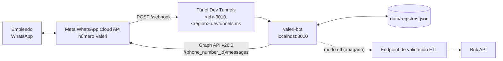
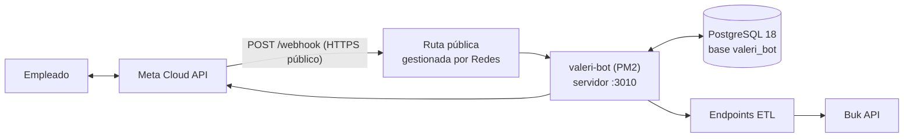
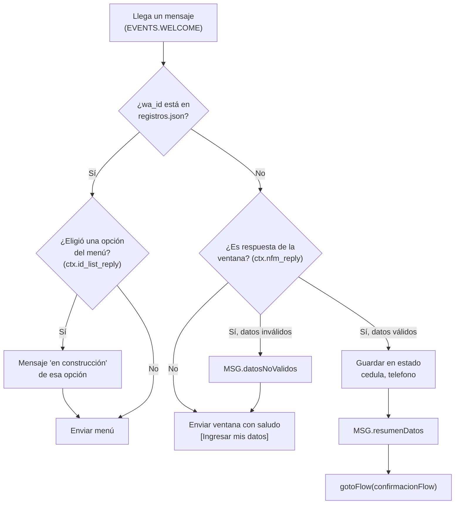
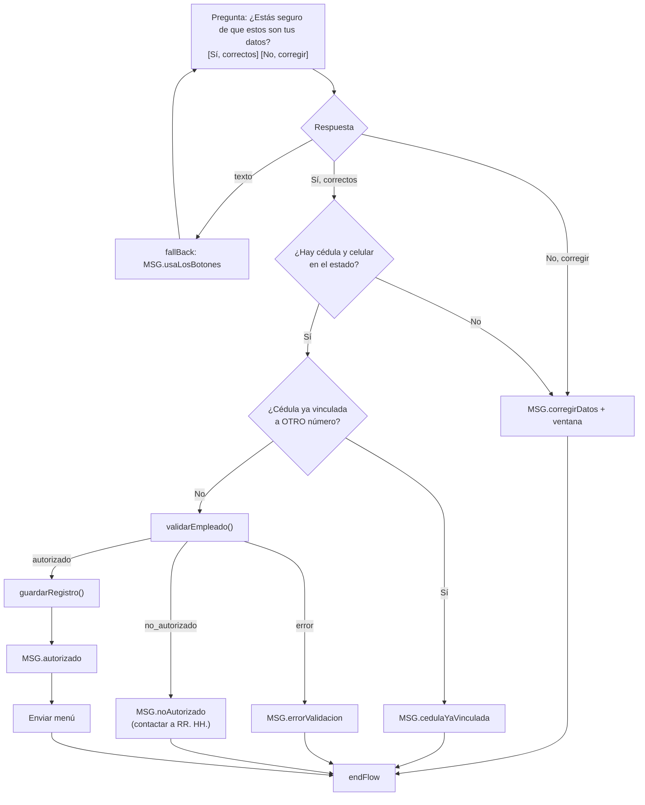
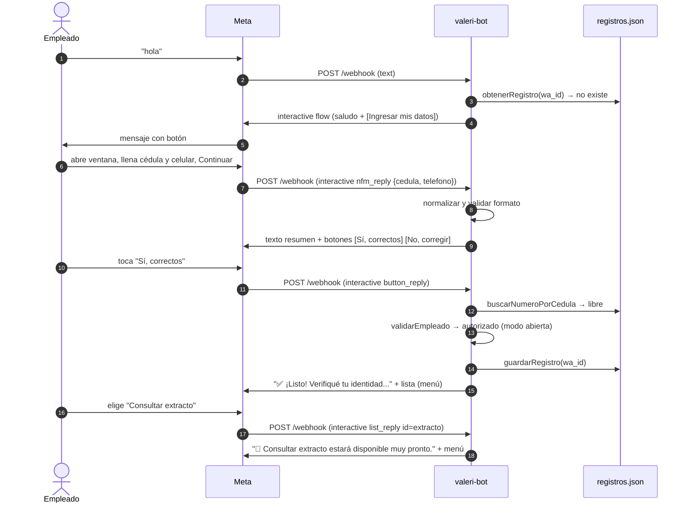

# Valeri — Documentación técnica

> **Audiencia:** desarrolladores y agentes de IA que van a operar, modificar o desplegar Valeri
> en el servidor interno. Está escrito para que se pueda reconstruir y desplegar el sistema
> sin contexto adicional. Si algo del código contradice este documento, el código manda y
> este documento debe corregirse en el mismo cambio.
>
> **Regla del proyecto:** cada cambio al código, a la configuración o a Meta se documenta aquí
> (sección afectada + historial §16) en el mismo cambio.
>
> Documentos relacionados: `GUIA_USUARIO.md` (no técnica), `00-SERVIDOR-E-INFRAESTRUCTURA.md`
> y `01-GUIA-NUEVO-AGENTE.md` (plataforma del servidor; leer §1, §4, §5, §6, §7, §8, §9 de la 01).

Última actualización: **2026-11-10**.

---

## Índice

1. Qué es Valeri
2. Estado actual (qué funciona y qué no)
3. Decisiones de arquitectura
4. Componentes y arquitectura
5. Identificadores de Meta
6. Variables de entorno
7. Estructura del código, archivo por archivo
8. Lógica de conversación (máquina de estados)
9. Ventana de registro (WhatsApp Flow)
10. Validación del empleado
11. Menú principal
12. Catálogo de mensajes
13. Datos y persistencia
14. Endpoints de Buk (referencia para ETL)
15. Operación: correr local, desplegar en el servidor, problemas conocidos
16. Historial de cambios
17. Pendientes

---

## 1. Qué es Valeri

Valeri es la asistente de WhatsApp de **Transportes Vigía** para conductores y personal administrativo.
Permite, desde WhatsApp y sin usar la plataforma web de Buk:

| Opción del menú | Qué hace | Estado |
|---|---|---|
| Consultar extracto | Envía el comprobante de pago (PDF) | En construcción |
| Días de vacaciones | Informa los días disponibles | En construcción |
| Solicitar vacaciones | Registra una solicitud de vacaciones | En construcción |
| Certificado laboral | Envía el certificado laboral (PDF) | En construcción |
| Hablar con agente | Pasa la conversación a un asesor de RR. HH. | En construcción |

Antes de usar el menú, cada número de WhatsApp pasa **una sola vez** por un registro de identidad.

Reparto de responsabilidades:

| Equipo | Responsabilidad |
|---|---|
| ETL / Integraciones | Endpoints hacia Buk (validación, extracto, días, vacaciones, datos del certificado) |
| Bot (este repositorio) | Conversación en WhatsApp, ventana de registro, menú, armado de respuestas y PDFs |
| Infraestructura | Servidor interno, PM2, PostgreSQL, ruta pública del webhook |

---

## 2. Estado actual

| Pieza | Estado | Verificado |
|---|---|---|
| Recepción de mensajes (webhook) por túnel local | Funciona | Sí, mensaje real 2026-11-10 |
| Envío de mensajes con la app de Meta Valeri | Funciona | Sí |
| Ventana de registro (WhatsApp Flow) publicada | Funciona | Sí, registro real completado |
| Confirmación con botones | Funciona | Sí |
| Validación de empleado, modo `abierta` (pruebas) | Activo | Sí (pruebas unitarias) |
| Validación de empleado, modo `etl` | Desarrollado, **apagado** | Sí, contra un ETL simulado (7 de 7 casos) |
| Regla "un empleado, un número" | Funciona (sobre JSON) | No probado con dos números reales |
| Menú principal (lista) | Desarrollado | Pendiente de prueba real |
| Opciones del menú | Responden "en construcción" | — |
| Código SMS | No desarrollado | — |
| Base de datos PostgreSQL | No desarrollada (se usa JSON) | — |
| Despliegue en servidor con PM2 | No realizado | — |

Fase actual: **desarrollo local** en el equipo del desarrollador.

---

## 3. Decisiones de arquitectura

| # | Decisión | Motivo |
|---|---|---|
| D1 | Servidor interno (Windows Server, ver `00-SERVIDOR…`), sin nube ni Docker | Plataforma estándar de la empresa (ADR-09 de la plataforma) |
| D2 | Node.js 24 + TypeScript, ES Modules, bundle con rollup | Igual que `paula-bot` (guía 01 §4) |
| D3 | BuilderBot `1.4.4` + `@builderbot/provider-meta` `1.4.4` | Framework estándar para bots de WhatsApp en la plataforma |
| D4 | WhatsApp Cloud API directo con Meta (sin intermediarios) | Sin costos de proveedor |
| D5 | Puerto **3010** | 3000 (`paula-api`) y 3009 (`paula-bot`) están ocupados. Confirmar libre en el servidor antes de desplegar |
| D6 | Todo con botones; solo se escribe dentro de la ventana de registro | Menos errores de digitación |
| D7 | Captura de cédula y celular con **WhatsApp Flow** (ventana tipo login) | Un solo paso, validación de formato en el formulario |
| D8 | No usar el número desde el que escribe el usuario | Usuarios con nombre de usuario `@` no exponen su número |
| D9 | Persistencia provisional en `data/registros.json` | Aún no hay base de datos; será `valeri_bot` en PostgreSQL |
| D10 | Validación con dos modos (`abierta` / `etl`) | Permite probar sin depender de ETL |
| D11 | Aislamiento: Valeri usa solo su app de Meta y su número | No afectar otros proyectos (Paula) |
| D12 | Todo el contenido visible en español | Requisito del negocio |
| D13 | Buk no genera el certificado laboral por API: el PDF se arma en el servidor con datos de ETL | Verificado en el contrato Swagger (149 rutas, ninguna genera documentos) |

---

## 4. Componentes y arquitectura

### 4.1 Hoy (local)



### 4.2 Objetivo (servidor)



### 4.3 Endpoints HTTP del bot

| Método y ruta | Quién lo usa | Qué hace |
|---|---|---|
| `GET /webhook` | Meta (una vez, al configurar) | Verificación: responde `hub.challenge` si `hub.verify_token` = `META_VERIFY_TOKEN`; si no, 403 "Invalid token!" |
| `POST /webhook` | Meta (cada mensaje) | Recibe mensajes y estados. Responde 200 "Messages enqueued" |
| `GET /health` | Monitoreo | `200 {"status":"ok","servicio":"valeri-bot"}` |
| `POST /` | BuilderBot (interno) | Ruta propia del provider; no se usa |

Los tres primeros los monta `@builderbot/provider-meta`; `/health` lo agrega `src/app.ts`.

### 4.4 Reglas de enrutamiento de Meta (importante)

- El webhook se configura por **app** de Meta (panel de la app **Pharitech/Valeri** → WhatsApp → Configuración → Webhook): URL `https://<host>/webhook`, token de verificación = `META_VERIFY_TOKEN`, campo suscrito `messages`.
- La cuenta de WhatsApp (WABA) puede tener un **override** (`override_callback_uri`) en `/{WABA_ID}/subscribed_apps` que **reemplaza** la URL del panel. Si los mensajes no llegan al bot, revisar primero ese valor:
  `GET https://graph.facebook.com/v26.0/2550144075397020/subscribed_apps` (con el token de la app Valeri).
- Un `POST` a `/{WABA_ID}/subscribed_apps` suscribe **la app dueña del token** usado. Con un token de otra app (p. ej. Paula) se agregaría esa otra app a la WABA de Valeri: **no hacerlo**.

---

## 5. Identificadores de Meta (Valeri)

| Dato | Valor |
|---|---|
| App de Meta | **Pharitech/Valeri** — App ID `919835907416840` |
| Número de WhatsApp | **+57 323 232 6150** — Phone Number ID `1344598332073548` |
| Cuenta de WhatsApp Business (WABA) | `2550144075397020` |
| Versión de Graph API | `v26.0` |
| Formulario de registro (Flow) | nombre `valeri_registro` — Flow ID `1791861852043799` — estado **PUBLISHED** — categoría `SIGN_IN` |
| Webhook en la app | `https://<túnel o ruta pública>/webhook` (hoy un túnel local temporal) |

En la misma cuenta de Meta de la empresa hay otros números y apps de **otros proyectos**: no usarlos ni usar sus tokens con Valeri (§4.4).

Los tokens viven **solo** en `valeri-bot/.env` (fuera de git).

---

## 6. Variables de entorno

Archivo `valeri-bot/.env` (no versionado). Plantilla: `valeri-bot/.env.example`. Se carga con `node --env-file=.env` (relativo al directorio de trabajo, por eso PM2 debe usar `cwd: valeri-bot`).

| Variable | Obligatoria | Ejemplo / valor actual | Uso |
|---|---|---|---|
| `PORT` | No (def. 3010) | `3010` | Puerto HTTP del bot |
| `META_JWT_TOKEN` | Sí | `EAAN...` | Token de acceso de la **app Pharitech/Valeri**. El actual es temporal (Explorador de la API, dura horas). En servidor: token permanente de usuario del sistema |
| `META_NUMBER_ID` | Sí | `1344598332073548` | Phone Number ID de Valeri |
| `META_WABA_ID` | No (informativo) | `2550144075397020` | Cuenta de WhatsApp de Valeri |
| `META_VERIFY_TOKEN` | Sí | (cadena aleatoria) | Debe coincidir con el token de verificación configurado en el webhook de la app |
| `META_VERSION` | No (def. `v26.0`) | `v26.0` | Versión de Graph API |
| `META_APP_SECRET` | No (recomendado) | vacío | Si se define, el provider rechaza (401) webhooks sin firma `X-Hub-Signature-256` válida |
| `META_FLOW_ID` | Sí | `1791861852043799` | ID del formulario de registro |
| `META_FLOW_DRAFT` | No (def. `true`) | `false` | `true` envía el formulario con `mode: draft` (solo borradores). Con el formulario publicado debe ser `false` |
| `VALERI_VALIDACION` | No (def. `etl`) | `abierta` | `abierta` = pruebas (todos autorizados). `etl` = producción |
| `ETL_VALIDACION_URL` | Si modo `etl` | vacío | URL del endpoint de validación de ETL (§10) |
| `ETL_TOKEN` | No | vacío | Se envía como `Authorization: Bearer` al endpoint de ETL |
| `TLS_EXTRA_CA` | No | `./certs/acronis-ca.pem` | CA del proxy corporativo para `https` (axios). Ver guía 00 §6 |
| `NODE_EXTRA_CA_CERTS` | No | `./certs/acronis-ca.pem` | Misma CA para `fetch` (undici) |

Al arrancar, el log muestra el modo de validación. Con `abierta` imprime una advertencia **MODO PRUEBAS**.

---

## 7. Estructura del código, archivo por archivo

```text
valeri-bot/
  package.json            # scripts build/start/dev/typecheck; deps fijadas (versión exacta)
  rollup.config.js        # src/app.ts -> dist/app.js (ESM), dependencias externas
  tsconfig.json           # strict, ES2022, moduleResolution Bundler
  .env / .env.example     # configuración (§6)
  .gitignore              # node_modules, dist, .env, certs, logs, data/
  meta/
    registro.flow.json    # definición del formulario (WhatsApp Flow)
  data/
    registros.json        # empleados autorizados (provisional, fuera de git)
  src/
    app.ts                # arranque
    tls-setup.ts          # CA corporativa (se importa de primero)
    config.ts             # lectura y validación de variables de entorno
    mensajes.ts           # TODOS los textos y títulos de botones
    validadores.ts        # normalización de cédula y celular
    formulario.ts         # envío y lectura de la ventana (Flow)
    menu.ts               # opciones y envío del menú (lista)
    validacion.ts         # validación del empleado (abierta / etl)
    registros.ts          # lectura/escritura de data/registros.json
    flows/
      bienvenida.flow.ts  # entrada de todo mensaje (EVENTS.WELCOME)
      registro.flow.ts    # confirmación con botones + validación (confirmacionFlow)
```

| Archivo | Responsabilidad | Detalles clave |
|---|---|---|
| `app.ts` | Crea provider Meta, flujos, `MemoryDB`, `/health`; arranca el servidor HTTP | Registra `unhandledRejection` y `uncaughtException` para que un error en un mensaje no tumbe el proceso. Imprime modo de validación y advertencia si falta `META_APP_SECRET` |
| `tls-setup.ts` | Si `TLS_EXTRA_CA` existe, la **añade** a `https.globalAgent.options.ca` | Nunca desactiva la verificación TLS |
| `config.ts` | Lee `process.env` una sola vez | `requerida()` lanza error si falta una variable obligatoria. `leerModoValidacion()` solo acepta `abierta`/`etl` |
| `mensajes.ts` | Textos (`MSG`) y botones (`BOTONES`) | Botones de respuesta ≤ 16 caracteres (el provider recorta a 16) |
| `validadores.ts` | `normalizarCedula`, `normalizarTelefono`, `formatearCedula`, `formatearTelefono`, `esBoton` | §9.3 |
| `formulario.ts` | `enviarFormulario(provider, to)` y `leerFormulario(ctx)` | El mensaje del Flow se arma a mano (ver §9.2). Registra en consola si Meta rechaza el envío |
| `menu.ts` | `OPCIONES_MENU`, `esOpcionMenu`, `enviarMenu` | Ids estables: `extracto`, `dias_vacaciones`, `solicitar_vacaciones`, `certificado`, `agente` |
| `validacion.ts` | `validarEmpleado(cedula, telefono)` | Devuelve `autorizado` / `no_autorizado` / `error`. Contrato de ETL en §10 |
| `registros.ts` | `obtenerRegistro`, `buscarNumeroPorCedula`, `guardarRegistro` | Lee y escribe el JSON completo en cada operación |
| `flows/bienvenida.flow.ts` | Punto de entrada de cualquier mensaje | §8 |
| `flows/registro.flow.ts` | `confirmacionFlow`: pregunta con botones, validación, guardado, menú | §8 |

Patrón importante de BuilderBot: **no encadenar varios `addAction` seguidos esperando respuestas**. En pruebas, un `addAction({ capture: true })` después de otro `addAction` no esperó y siguió al paso siguiente. Por eso las respuestas de la ventana y del menú llegan como **mensajes nuevos** y las atiende `bienvenidaFlow`; solo la confirmación usa `addAnswer` con `capture`.

---

## 8. Lógica de conversación

### 8.1 Decisión al llegar un mensaje (`bienvenidaFlow`)



### 8.2 Confirmación y validación (`confirmacionFlow`)



### 8.3 Secuencia completa (primer uso, modo abierta)



### 8.4 Estado de la conversación

- `MemoryDB` (memoria del proceso) guarda el estado de BuilderBot: `cedula` y `telefono` entre la ventana y la confirmación. **Se pierde si el bot se reinicia**; por eso la confirmación verifica que existan y, si no, vuelve a enviar la ventana.
- Lo permanente (quién está autorizado) está en `data/registros.json`.

### 8.5 Campos de `ctx` que usa el bot (vienen del provider Meta)

| Campo | Cuándo llega | Uso |
|---|---|---|
| `ctx.from` | siempre | wa_id del usuario (número sin `+`). Clave de `registros.json` |
| `ctx.body` | siempre | Texto, o título del botón/opción elegida |
| `ctx.nfm_reply` | respuesta de la ventana | Objeto con `cedula`, `telefono` y `flow_token` |
| `ctx.id_list_reply` | opción del menú | Id de la opción (`extracto`, `agente`, etc.) |

---

## 9. Ventana de registro (WhatsApp Flow)

### 9.1 Definición (`meta/registro.flow.json`)

- Versión de Flow JSON `7.2`, una pantalla `REGISTRO` (`terminal: true`), sin endpoint (formulario estático).
- Campos:

| name | label (≤ 20) | input-type | Reglas | helper-text |
|---|---|---|---|---|
| `cedula` | Número de cédula | `number` | obligatorio, 5 a 10 caracteres | Solo números, sin puntos |
| `telefono` | Celular en Buk | `phone` | obligatorio | El registrado en Buk. Ej: 3001234567 |

- Botón inferior **Continuar** con acción `complete` y payload `{ "cedula": "${form.cedula}", "telefono": "${form.telefono}" }`. Meta entrega ese payload al bot en `ctx.nfm_reply`.

### 9.2 Envío (`formulario.ts → enviarFormulario`)

Se usa `provider.sendMessageMeta` con este cuerpo (no `provider.sendFlow`, porque este siempre agrega `flow_action_payload.data` y Meta rechaza un objeto vacío con el error 131009 *"must be of type dynamic_object"*):

```json
{
  "messaging_product": "whatsapp",
  "recipient_type": "individual",
  "to": "<wa_id>",
  "type": "interactive",
  "interactive": {
    "type": "flow",
    "header": { "type": "text", "text": "¡Hola! Soy Valeri 👋" },
    "body": { "text": "<saludo e instrucción>" },
    "footer": { "text": "Transportes Vigía" },
    "action": {
      "name": "flow",
      "parameters": {
        "flow_message_version": "3",
        "flow_token": "valeri-registro",
        "flow_id": "<META_FLOW_ID>",
        "flow_cta": "Ingresar mis datos",
        "flow_action": "navigate",
        "flow_action_payload": { "screen": "REGISTRO" }
      }
    }
  }
}
```

Si `META_FLOW_DRAFT=true` se agrega `"mode": "draft"` en `parameters`. En borrador, Meta **reemplaza** encabezado y cuerpo por un texto de prueba en inglés ("Hello! This is a test message…") y muestra "This flow is only for testing". Por eso el formulario se publicó.

### 9.3 Validación y normalización del lado del bot (`validadores.ts`)

| Función | Acepta | Resultado |
|---|---|---|
| `normalizarCedula` | `1023456789`, `1.023.456.789`, `CC 12.345.678`, con espacios | Solo dígitos, sin ceros a la izquierda, 5 a 10 dígitos. Rechaza todo ceros |
| `normalizarTelefono` | `3001234567`, `300 123 4567`, `+57 300…`, `57300…` (12 díg.), `0057…`, `(300) 123-4567` | 10 dígitos que empiezan por 3 |
| `formatearCedula` | `1023456789` | `1.023.456.789` (solo para mostrar) |
| `formatearTelefono` | `3001234567` | `300 123 4567` (solo para mostrar) |
| `esBoton` | Compara la respuesta con el título del botón | Ignora tildes, mayúsculas y espacios |

Probado con 21 casos (todos correctos).

### 9.4 Gestión del formulario en Meta

Un formulario **publicado no se puede editar**. Para cambiar textos o campos de la ventana:

1. Editar `meta/registro.flow.json` (respetar límites: label ≤ 20 caracteres).
2. Crear un formulario nuevo como borrador en la WABA de Valeri:
   `POST https://graph.facebook.com/v26.0/2550144075397020/flows` (multipart: `name`, `categories=["SIGN_IN"]`, `flow_json`). Revisar `validation_errors` en la respuesta.
3. Probar con `META_FLOW_ID=<nuevo>` y `META_FLOW_DRAFT=true`.
4. Publicar: `POST https://graph.facebook.com/v26.0/<FLOW_ID>/publish`. Confirmar con `GET /<FLOW_ID>?fields=status` → `PUBLISHED`.
5. Poner `META_FLOW_DRAFT=false` y reiniciar el bot.

Para actualizar un **borrador** (no publicado): `POST /<FLOW_ID>/assets` (multipart: `name=flow.json`, `asset_type=FLOW_JSON`, `file`).

Los textos del mensaje que **abre** la ventana (encabezado, cuerpo, pie, botón) están en `src/mensajes.ts` (`MSG.formulario`) y se cambian sin tocar Meta.

---

## 10. Validación del empleado (`validacion.ts`)

### 10.1 Modos

| `VALERI_VALIDACION` | Comportamiento | Uso |
|---|---|---|
| `abierta` | Devuelve siempre `autorizado`. No consulta nada | **Pruebas (activo hoy)** |
| `etl` | Consulta `ETL_VALIDACION_URL` | Producción (desarrollado, apagado) |

Para activar en producción: `VALERI_VALIDACION=etl`, `ETL_VALIDACION_URL=<url>`, `ETL_TOKEN=<token si aplica>`, reiniciar.

### 10.2 Contrato PROVISIONAL con ETL (confirmar con ETL antes de activar)

```
GET {ETL_VALIDACION_URL}?cedula=1023456789&telefono=3001234567
Accept: application/json
Authorization: Bearer {ETL_TOKEN}        (solo si ETL_TOKEN está definido)
Tiempo máximo: 15 s
```

Respuestas esperadas (HTTP 200):

```json
{ "autorizado": true,  "id_buk": 1234 }
{ "autorizado": false, "motivo": "no_encontrado" }
{ "autorizado": false, "motivo": "inactivo" }
{ "autorizado": false, "motivo": "telefono_no_coincide" }
```

Lógica esperada del lado de ETL: `GET /employees/{cédula}` en Buk; autorizado si `data.status = "activo"` y el teléfono registrado (normalizado a 10 dígitos) es igual al enviado. **Pendiente de ETL:** confirmar el nombre del campo de teléfono en la ficha de Buk y si hay más de uno.

### 10.3 Interpretación en el bot

| Respuesta de ETL | Resultado | Mensaje al usuario |
|---|---|---|
| 200 `autorizado: true` | `autorizado` (con `idBuk`) | `MSG.autorizado` + menú |
| 200 `autorizado: false` | `no_autorizado` (motivo; desconocido si no es uno de los tres) | `MSG.noAutorizado` |
| 200 sin campo `autorizado` | `error` | `MSG.errorValidacion` |
| Código distinto de 2xx | `error` | `MSG.errorValidacion` |
| Sin URL configurada | `error` | `MSG.errorValidacion` |
| Sin conexión / tiempo agotado | `error` | `MSG.errorValidacion` |

Verificado con un servidor ETL simulado en local: 7 de 7 casos correctos.

### 10.4 Regla "un empleado, un número"

Antes de validar, `buscarNumeroPorCedula(cedula)`: si la cédula ya está vinculada a **otro** wa_id, se responde `MSG.cedulaYaVinculada` y no se registra. Liberar un vínculo (cambio de celular): borrar la entrada de ese wa_id en `data/registros.json` (en el futuro, en la base de datos).

---

## 11. Menú principal (`menu.ts`)

Mensaje interactivo tipo **lista** (`provider.sendList`):

| Elemento | Valor | Límite Meta |
|---|---|---|
| Encabezado | 📋 Menú principal | 60 |
| Cuerpo | ¿En qué te puedo ayudar hoy? 😊 / Elige una opción del menú: | 1024 |
| Pie | Transportes Vigía | 60 |
| Botón | Ver opciones | 20 |
| Sección | Opciones | 24 |

| id | Título (≤ 24) | Descripción (≤ 72) |
|---|---|---|
| `extracto` | Consultar extracto | Descarga tu comprobante de pago en PDF |
| `dias_vacaciones` | Días de vacaciones | Consulta tus días disponibles |
| `solicitar_vacaciones` | Solicitar vacaciones | Pide tus días de descanso |
| `certificado` | Certificado laboral | Descarga tu certificado en PDF |
| `agente` | Hablar con agente | Te atiende un asesor de Recursos Humanos |

- El menú se muestra **sin saludo**: justo después de validarse y cada vez que un usuario autorizado escribe.
- Al elegir una opción llega `ctx.id_list_reply`. Hoy cada opción responde `MSG.opcionEnConstruccion(título)` y vuelve a enviar el menú.
- Máximo 10 opciones en total. No cambiar los `id` sin actualizar `bienvenida.flow.ts`.

---

## 12. Catálogo de mensajes (`mensajes.ts`)

| Clave | Cuándo se envía |
|---|---|
| `MSG.formulario` | Usuario no registrado escribe: saludo + botón de la ventana |
| `MSG.datosNoValidos` | La ventana devolvió cédula o celular con formato inválido |
| `MSG.resumenDatos` | Datos válidos: muestra cédula y celular formateados |
| `MSG.preguntaConfirmacion` | Pregunta con botones [Sí, correctos] [No, corregir] |
| `MSG.usaLosBotones` | Escribió texto en vez de tocar un botón |
| `MSG.corregirDatos` | Eligió corregir o se perdió el estado |
| `MSG.autorizado` | Validación exitosa (antes del menú) |
| `MSG.noAutorizado` | No está registrado correctamente en Buk: contactar a Recursos Humanos |
| `MSG.cedulaYaVinculada` | La cédula está vinculada a otro número |
| `MSG.errorValidacion` | Falla técnica al validar: intentar más tarde |
| `MSG.menu` | Textos del menú (lista) |
| `MSG.opcionEnConstruccion` | Opción del menú aún no desarrollada |

---

## 13. Datos y persistencia

### 13.1 `data/registros.json` (provisional)

```json
{
  "573001234567": {
    "cedula": "1023456789",
    "telefono": "3001234567",
    "confirmadoEn": "2026-11-10T16:00:21.748Z",
    "idBuk": 1234
  }
}
```

- Clave: wa_id. Solo se guardan empleados **autorizados**.
- `idBuk` solo existe si ETL lo devuelve.
- Contiene datos personales: está en `.gitignore` y no debe compartirse.
- Volver a probar el registro desde un número: borrar su entrada (o el archivo).

### 13.2 Base de datos objetivo (no desarrollada)

PostgreSQL 18 del servidor, base nueva `valeri_bot` con rol propio (guía 00 §4), acceso con Prisma (guía 01 §5). Tablas previstas: vínculos (wa_id ↔ cédula, único en ambos sentidos), códigos SMS (hash, intentos, vencimiento), intentos de validación, mensajes procesados (idempotencia) y auditoría. Usar el nombre con guion bajo (`valeri_bot`); con guion obliga a comillas en todo SQL.

---

## 14. Endpoints de Buk (referencia para ETL)

Base: `https://transportesvigia.buk.co/api/v1/colombia`. Autenticación: cabecera `auth_token: <token>` (valor crudo, sin `Bearer`). Swagger: `https://transportesvigia.buk.co/apidocs?country=colombia&language=es` (contrato JSON en `/api/colombia/es/api_docs`).

Regla de identificación: algunos endpoints aceptan la **cédula** y otros exigen el **id de Buk** (`data.id` de `GET /employees/{cédula}`).

| Uso en Valeri | Colección → endpoint | Acepta | Notas verificadas |
|---|---|---|---|
| Validación | Colaboradores → `GET /employees/{x}` | cédula o id | Respuesta en `data`: `id`, `full_name`, `document_number`, `status` (`activo`), `active_since`, `current_job` (contrato, salario, `company_id`) |
| Extracto | Comprobantes → `GET /employees/{id}/statements/{year}-{month}.pdf` ("Archivo de la Comprobante") | solo id | 200 = PDF (~55 KB, empieza por `%PDF`); 404 = mes sin liquidar (`no se encontró información para MM-AAAA`). "Último extracto": retroceder mes a mes (máx. 12). ETL entrega la URL; el bot descarga con `auth_token` y envía el PDF |
| Extracto en datos | Comprobantes → `GET /employees/{x}/payroll_detail` | cédula o id | Alternativa en JSON |
| Días de vacaciones | Colaboradores → `GET /employees/{x}/vacations_available` | cédula o id | `vacations[]` con `name` (tipo) y `stock` (días). Opcional `date=DD-MM-YYYY`, `discount=true` |
| Días hábiles de un rango | Vacaciones → `GET /vacations/business_days?start_date&end_date` | — | `{"business_days": N}` (fechas `YYYY-MM-DD`, inclusivas) |
| Solicitar vacaciones | Vacaciones → `POST /vacations` | id (`employee_id`) | Body: `employee_id`, `type` (`legales`), `start_date`, `end_date`, `percent_day`, `workday_stage`. **Nunca ejecutado**: confirmar si `percent_day` es 1 o 100 y si queda aprobada |
| Estado de solicitudes | Vacaciones → `GET /vacations/requested` | — | No filtra por empleado: paginar y filtrar `employee_id` |
| Certificado (datos) | Colaboradores → `GET /employees/{x}`, `GET /employees/{id}/jobs` (`role.name`, `wage`), Empresas → `GET /companies` (`name`, `nit`) | — | Buk **no** genera el certificado por API. El PDF se arma en el servidor con plantilla de RR. HH. |
| Documentos del expediente | Documentos → `GET /employees/{id}/docs`, `GET /employees/{id}/docs/{file_id}` | id | Solo devuelve documentos ya generados en la web de Buk; la descarga responde con redirección (seguirla) |

Permisos del token de Buk: Empleados lectura, "ver información sensible: Sí", Vacaciones lectura (y modificación solo si se crean vacaciones), documentos "ver y descargar: Sí".

---

## 15. Operación

### 15.1 Correr en local

```powershell
cd valeri-bot
npm.cmd install          # en este equipo PowerShell bloquea npm.ps1: usar npm.cmd
npm.cmd run build        # rollup -> dist/app.js
npm.cmd start            # node --env-file=.env ./dist/app.js
```

- Túnel: Kiro/VS Code → panel Ports → Forward a Port `3010` → visibilidad **Public**. La URL del túnel + `/webhook` va en el webhook de la app Valeri en Meta.
- Kiro no trae `code-tunnel.exe`; se copió desde `AppData\Local\Programs\Microsoft VS Code\bin\` a `AppData\Local\Programs\Kiro\bin\`. Si Kiro se actualiza, repetir la copia.
- Verificar: `GET http://localhost:3010/health` → 200.
- Log esperado al arrancar: `escuchando en el puerto 3010`, `validación de empleados: modo "abierta"`, `MODO PRUEBAS…`, `Connected Provider`.

### 15.2 Despliegue en el servidor (pendiente; pasos a seguir)

1. Confirmar puerto libre: `Get-NetTCPConnection -State Listen -LocalPort 3010` (sin resultado = libre). Anotarlo en la tabla de puertos de `00-SERVIDOR…` §5.
2. Copiar `valeri-bot/` al repositorio del servidor (sin `node_modules`, `dist`, `.env`, `data`).
3. Crear `.env` desde `.env.example` con: token **permanente** de la app Valeri, `META_APP_SECRET`, `VALERI_VALIDACION=etl`, `ETL_VALIDACION_URL`.
4. Si hay inspección SSL: guardar la CA en `valeri-bot/certs/` y definir `TLS_EXTRA_CA` y `NODE_EXTRA_CA_CERTS`.
5. `npm install` y `npm run build`.
6. Prueba manual: `node --env-file=.env dist/app.js` y `GET /health`.
7. Registrar en `deploy/ecosystem.config.cjs`:
   ```js
   {
     name: 'valeri-bot',
     script: 'dist/app.js',
     cwd: join(root, 'valeri-bot'),
     interpreter: 'node',
     interpreter_args: '--env-file=.env',
     instances: 1,
     exec_mode: 'fork',
     autorestart: true,
     max_memory_restart: '512M',
     env: { NODE_ENV: 'production' },
   }
   ```
8. `pm2 start deploy/ecosystem.config.cjs` → `pm2 save`. Verificar `pm2 describe valeri-bot` (`unstable restarts: 0`) y `pm2 logs valeri-bot`.
9. Abrir el puerto en el firewall si la ruta pública llega desde otro equipo (requiere Administrador).
10. Pedir a Redes la ruta pública HTTPS hacia `:3010`, y configurarla como webhook de la app Valeri (`/webhook`, token = `META_VERIFY_TOKEN`, campo `messages`). Revisar el override de la WABA (§4.4).
11. Si `data/registros.json` debe conservarse, copiarlo a `valeri-bot/data/`.

### 15.3 Problemas conocidos y solución

| Síntoma | Causa | Solución |
|---|---|---|
| El bot no responde a mensajes reales pero sí envía | Meta entrega el webhook a otra URL (override de la WABA) o el túnel está caído | §4.4; `GET /health` por la URL pública |
| `403 Invalid token!` al verificar el webhook | `META_VERIFY_TOKEN` distinto al del panel, o el bot no se reinició tras cambiar `.env` | Igualar y reiniciar |
| `EADDRINUSE :::3010` | Quedó otro proceso `node dist/app.js` escuchando | Detener ese proceso y arrancar de nuevo |
| `(#131009) … must be of type dynamic_object` | `flow_action_payload.data` vacío | Ya resuelto en `formulario.ts` (no se envía `data`) |
| "TextInput … label must be 20 characters or less" | Etiqueta de la ventana muy larga | Etiquetas ≤ 20 caracteres |
| Mensaje en inglés "Hello! This is a test message…" | Formulario en borrador | Publicarlo y `META_FLOW_DRAFT=false` |
| El bot deja de enviar mensajes de repente | Venció el token temporal | Generar token nuevo de la app Valeri (o permanente) |
| Respuestas duplicadas | Meta reintenta el webhook cuando el bot falla | Pendiente: idempotencia por `message_id` |
| `.env: not found` al arrancar | Se ejecutó fuera de `valeri-bot` | Ejecutar con el directorio de trabajo en `valeri-bot` |

---

## 16. Historial de cambios

| Fecha | Cambio |
|---|---|
| 2026-11-09 | Investigación de endpoints de Buk (verificados en vivo, solo lectura) |
| 2026-11-10 | Se descarta AWS: Valeri va en el servidor interno. Se borra `ARQUITECTURA_AWS.md` |
| 2026-11-10 | Caparazón con BuilderBot; webhook por túnel; número y app de Valeri conectados (token de la app Valeri) |
| 2026-11-10 | Registro con ventana (WhatsApp Flow) en lugar de texto suelto; se quita "Usar mi WhatsApp" |
| 2026-11-10 | Mensaje de la ventana armado a mano (error 131009); etiqueta "Celular en Buk"; saludo dentro del mensaje de la ventana |
| 2026-11-10 | Formulario `valeri_registro` **publicado**; `META_FLOW_DRAFT=false` |
| 2026-11-10 | Validación del empleado (`abierta` activa / `etl` desarrollada y apagada); mensaje de no autorizado (contactar a RR. HH.); regla "un empleado, un número"; mensaje de error técnico |
| 2026-11-10 | Menú principal tipo lista con 5 opciones (incluye "Hablar con agente"); opciones responden "en construcción" |
| 2026-11-10 | Se eliminan los `.md` de APIs (su contenido queda en §14); se crea `GUIA_USUARIO.md` |
| 2026-11-10 | Código y documentación publicados en `github.com/brayanfonseca-ai/valeri-bot` (repositorio **público**): sin `.env`, sin datos, ejemplos con datos ficticios. Las guías internas del servidor (`00-…`, `01-…`) no se publican |

---

## 17. Pendientes

| # | Tema | Responsable |
|---|---|---|
| 1 | Endpoint de validación de ETL (confirmar contrato §10.2 y campo de teléfono en Buk) y activar `VALERI_VALIDACION=etl` | ETL + Bot |
| 2 | Conectar cada opción del menú con su endpoint de ETL | ETL + Bot |
| 3 | "Hablar con agente": definir a dónde se transfiere (portal, número, horario) | Negocio + Bot |
| 4 | Código de verificación por SMS (proveedor externo) antes de guardar el registro | Bot (al final) |
| 5 | Token permanente de la app Valeri (el actual vence en horas) | Meta / TI |
| 6 | `META_APP_SECRET` para validar firmas del webhook | Meta / TI |
| 7 | Base de datos `valeri_bot` (PostgreSQL + Prisma) en lugar del JSON | Bot + Infraestructura |
| 8 | Idempotencia por `message_id` (evitar respuestas duplicadas) | Bot |
| 9 | Despliegue en el servidor con PM2 (§15.2) y ruta pública del webhook | Infraestructura + Redes |
| 10 | Proceso para liberar el vínculo cuando un empleado cambia de celular | RR. HH. / TI |
