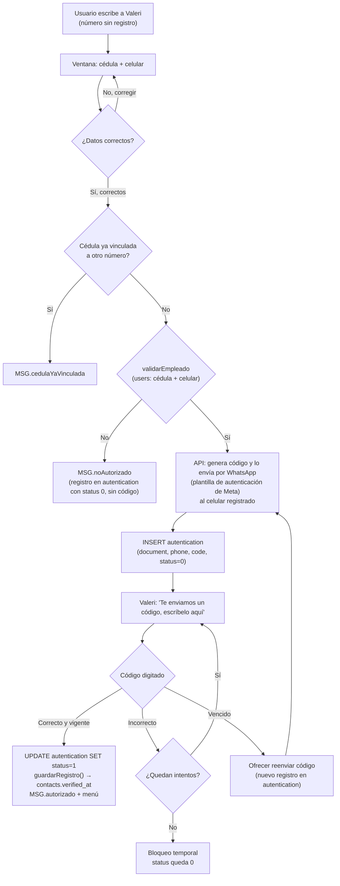

# Valeri — Autenticación por código (diseño previsto)

> **Estado:** PREVISTO. Solo existe la tabla `autentication` en la base `valeri_bot` (vacía).
> **No hay código que la use** y el flujo actual de registro **no se ha modificado**.
> Este documento guarda todo el contexto para que, cuando se pida "implementa la autenticación",
> se pueda hacer sin volver a preguntar lo ya definido.
>
> **Audiencia:** desarrolladores y agentes de IA que van a implementar esta función.
> **Fecha de definición:** 2026-11-25. Documento relacionado: `docs/ARQUITECTURA_VALERI.md` (§9, §12.1, §17).

---

## Índice

1. Qué pidió el negocio (requisitos literales)
2. Objetivo
3. Cómo funciona HOY el registro (punto de partida)
4. Flujo previsto paso a paso
5. Tabla `autentication` (ya creada)
6. Reglas de negocio
7. Dónde se conecta con el código actual
8. Envío del código por WhatsApp (Meta)
9. Seguridad
10. Mensajes al usuario (borrador)
11. Consultas SQL de control
12. Decisiones pendientes (preguntar antes de implementar)
13. Plan de implementación (checklist)
14. Qué NO hacer

---

## 1. Qué pidió el negocio (requisitos literales)

Resumen fiel de lo que pidió el responsable del proyecto:

- Crear una tabla llamada **`autentication`** (así, con esa ortografía).
- "Aún no se va a hacer, es un pensado para más adelante": **solo crear la tabla, no modificar lo que existe**.
- El usuario ingresa **cédula y teléfono**.
- Esa autenticación **debe pasar por una API** y **enviar un mensaje completo a WhatsApp** para su validación.
- Meta envía un mensaje con un **número (código) de autenticación**.
- El usuario debe **colocar ese número en el registro** para que lo deje pasar.
- En la tabla debe quedar **el registro completo**: cédula, teléfono y el código de autenticación, para tener **una traza**.
- Un **cuarto campo de estado**: **`1` = aprobado**, **`0` = no pasó la autenticación**.
- Finalidad: **control de ingresos**: saber quién sí es, quién no, quién está intentando ingresar al aplicativo.
- A partir de ahí se define **quién puede entrar a las funcionalidades y quién no**.

## 2. Objetivo

Agregar un **segundo factor** al registro actual: además de que la cédula y el celular coincidan con la tabla `users`,
el colaborador debe demostrar que **tiene en sus manos el celular registrado**, digitando un código que se le envía
por WhatsApp a ese número. Cada intento queda guardado en `autentication` como traza de auditoría.

## 3. Cómo funciona HOY el registro (punto de partida)

Archivos: `valeri-bot/src/flows/bienvenida.flow.ts`, `flows/registro.flow.ts` (`confirmacionFlow`),
`validacion.ts`, `registros.ts`, `sesiones.ts` (`registrarIntento`).

1. Un número sin registro escribe → se le envía la ventana (WhatsApp Flow v3, `META_FLOW_ID=1191643797147654`)
   con **cédula** (5–15 dígitos) y **celular** (10 dígitos).
2. El bot pregunta "¿Tus datos son correctos?" → botones **"Sí, correctos"** / **"No, corregir"**.
3. Con "Sí, correctos" (`confirmacionFlow`):
   1. Regla **un empleado, un número**: si la cédula ya está validada en otro `wa_id` → `MSG.cedulaYaVinculada`.
   2. `validarEmpleado(cedula, telefono)` (modo `VALERI_VALIDACION=bd`): la cédula existe en `users`, está activa
      y `users.phone` es igual al celular escrito.
   3. Si es válido → `guardarRegistro()` (tabla `contacts`: `user_id` + `verified_at`) → `MSG.autorizado` + menú.
   4. Si no → un único mensaje de rechazo (`MSG.noAutorizado`: no está registrado, actualizar datos en Buk y
      comunicarse con Gestión Humana). No se revela qué dato falló.
4. Cada intento se guarda en `auth_attempts` (`AUTORIZADO`, `NO_REGISTRADO`, `CEDULA_EN_OTRO_NUMERO`, `ERROR`).
5. Una vez validado, el número **no vuelve a pasar por el registro** (sesiones de 10 min, pero el vínculo en
   `contacts` permanece).

**Hoy no hay código**: quien conozca cédula + celular de un empleado podría registrarse desde otro WhatsApp.
Eso es lo que resuelve esta función.

## 4. Flujo previsto paso a paso



Detalle de cada paso:

| # | Paso | Qué hace el sistema | Qué queda en `autentication` |
|---|---|---|---|
| 1 | Usuario envía cédula y celular | Igual que hoy (ventana + confirmación) | Nada todavía |
| 2 | Validación contra `users` | Igual que hoy (`validarEmpleado`) | Si falla: fila con `status=0` (ver decisión §12.4) |
| 3 | Generar y enviar código | API genera un código de 6 dígitos y lo envía por WhatsApp al **celular registrado** | Fila nueva: `document`, `phone`, `code`, `status=0`, `created_at` |
| 4 | Usuario digita el código | El bot lo compara con el último código vigente de esa cédula + teléfono | — |
| 5a | Código correcto | Se marca aprobado y se hace el registro actual (`guardarRegistro`) | `status=1` en esa fila |
| 5b | Código incorrecto / vencido / sin intentos | No se registra el número | `status` sigue en `0` |

## 5. Tabla `autentication` (ya creada)

- **Migración:** `valeri-bot/prisma/migrations/20261125090000_autentication/migration.sql` (aplicada con `prisma migrate deploy`).
- **Modelo Prisma:** `Autentication` en `valeri-bot/prisma/schema.prisma` (`@@map("autentication")`).
- **Cliente Prisma:** **aún NO regenerado** (para no detener el bot). Al implementar: `pm2 stop valeri-bot` →
  `npx prisma generate` → `npx rollup -c` → `pm2 start valeri-bot` (si el bot corre, `generate` da `EPERM`).
- **Permisos:** `desarrollo` (dueño); `consulta` solo lectura (`SELECT`) por los privilegios por defecto.

| Columna | Tipo | Nulo | Por defecto | Significado |
|---|---|---|---|---|
| `id` | `TEXT` (uuid) | No | `uuid()` en Prisma | Identificador del intento |
| `document` | `TEXT` | No | — | Cédula que escribió el usuario |
| `phone` | `TEXT` | No | — | Celular que escribió el usuario (10 dígitos) |
| `code` | `TEXT` | No | — | Código enviado por WhatsApp (texto para conservar ceros a la izquierda) |
| `status` | `SMALLINT` | No | `0` | **`1` = aprobado**, **`0` = no pasó** (o aún no lo digitó) |
| `created_at` | `TIMESTAMP(3)` | No | `CURRENT_TIMESTAMP` | Fecha y hora del intento (UTC) |

Índices: `autentication_document_idx`, `autentication_phone_idx`, `autentication_created_at_idx`.

Comentario en la tabla: *"Traza de autenticación por código (prevista, aún no se usa). status: 1 = aprobado, 0 = no pasó."*

SQL de creación (referencia):

```sql
CREATE TABLE "autentication" (
    "id" TEXT NOT NULL,
    "document" TEXT NOT NULL,
    "phone" TEXT NOT NULL,
    "code" TEXT NOT NULL,
    "status" SMALLINT NOT NULL DEFAULT 0,
    "created_at" TIMESTAMP(3) NOT NULL DEFAULT CURRENT_TIMESTAMP,
    CONSTRAINT "autentication_pkey" PRIMARY KEY ("id")
);
```

**Columnas que probablemente harán falta al implementar** (NO creadas; requieren autorización y una migración
aditiva nueva, sin tocar las existentes):

| Columna sugerida | Para qué |
|---|---|
| `wa_id` | Número de WhatsApp desde el que se intenta (puede ser distinto al `phone` escrito: clave para detectar suplantación) |
| `expires_at` | Vencimiento del código (p. ej. 5 minutos) |
| `attempts` | Intentos fallidos de digitar el código |
| `verified_at` | Momento en que se aprobó |
| `meta_message_id` | `id` del mensaje de Meta con el código (para rastrear entrega/lectura) |
| `motivo` | Por qué quedó en 0: `codigo_incorrecto`, `vencido`, `sin_intentos`, `no_registrado`, `error_envio` |

## 6. Reglas de negocio

1. **Un registro por intento**: cada código enviado es una fila nueva. Nunca se borran filas (es la traza).
2. **`status`** solo toma `0` o `1`. Arranca en `0`; pasa a `1` únicamente cuando el código es correcto y vigente.
3. El código se envía **al celular registrado en `users`** (que debe ser igual al escrito), **no** al `wa_id` desde
   el que se escribe. Así, quien tenga la cédula y el celular de otro no puede pasar sin el teléfono físico.
4. Solo se envía código **si la validación contra `users` ya pasó** (no gastar mensajes en datos inválidos).
5. Sin `status=1` no se llama a `guardarRegistro()`: el número **no** accede al menú ni a las funcionalidades.
6. Se mantiene la regla **un empleado, un número** y el **mensaje único de rechazo** (no revelar qué dato falló).
7. Un número ya validado **no** vuelve a pedir código (igual que hoy no vuelve a pedir el registro), salvo que se
   decida re-autenticar periódicamente (§12.6).

## 7. Dónde se conecta con el código actual

| Archivo | Cambio previsto |
|---|---|
| `src/flows/registro.flow.ts` (`confirmacionFlow`) | Tras `validarEmpleado` = autorizado: **en lugar de** `guardarRegistro`, llamar a "enviar código" y pasar al nuevo flujo de captura del código |
| `src/flows/codigo.flow.ts` (**nuevo**) | Evento `VALERI_CODIGO`: captura el texto, valida formato (6 dígitos), compara, maneja intentos, reenvío y vencimiento; si es correcto → `guardarRegistro` + `MSG.autorizado` + menú |
| `src/autenticacion.ts` (**nuevo**) | `generarCodigo()` (con `crypto.randomInt`), `crearAutenticacion()`, `verificarCodigo()`, `marcarAprobado()`; acceso a la tabla con Prisma |
| `src/flows/bienvenida.flow.ts` | Si el número tiene un código pendiente y escribe texto → enrutar al flujo del código, no a la ventana |
| `src/mensajes.ts` | Textos nuevos (§10) |
| `src/config.ts` / `.env` / `.env.example` | `VALERI_AUTENTICACION=apagada|whatsapp` (interruptor), `AUTENTICACION_API_URL`, `AUTENTICACION_TIEMPO_MIN=5`, `AUTENTICACION_MAX_INTENTOS=3`, `META_PLANTILLA_CODIGO` |
| `src/sesiones.ts` | Auditoría: `AUTH_CODE_SENT`, `AUTH_CODE_OK`, `AUTH_CODE_FAIL` en `audit_events` (sin el código) |
| `src/app.ts` | Registrar el flujo nuevo en `createFlow` |

**Interruptor obligatorio:** con `VALERI_AUTENTICACION=apagada` el bot debe funcionar exactamente como hoy.
Así se puede desplegar el código sin activar la función y revertir con solo cambiar la variable.

## 8. Envío del código por WhatsApp (Meta)

- Meta **exige plantilla** de categoría **AUTHENTICATION** para enviar códigos (OTP). Hay que crearla y que Meta
  la apruebe en la WABA `2550144075397020` (app `919835907416840`, número `1344598332073548`).
- La plantilla de autenticación tiene texto fijo de Meta ("*{{1}}* es tu código de verificación…"), opción de
  aviso de seguridad ("No compartas este código") y vencimiento, y botón **"Copiar código"**.
- Una plantilla se puede enviar **fuera de la ventana de 24 h** y a un número que nunca le ha escrito a Valeri
  (necesario porque el código va al celular registrado, que puede no ser el `wa_id` del chat).
- Tiene costo por conversación de autenticación (tarifa de Meta para Colombia).
- Envío: `POST /{META_NUMBER_ID}/messages` con `type: template`, `template.name`, `language.code: es`, componentes
  `body` (parámetro = código) y `button` `sub_type: url` / `otp` (según el tipo de botón elegido).
- **"Pasar por una API"**: el pedido indica que la generación/envío del código pasa por una API. Opciones (§12.1):
  la API de ETL en AWS, una Lambda propia, o el propio bot llamando directo a Meta.

## 9. Seguridad

- Código de **6 dígitos** generado con `crypto.randomInt(0, 1_000_000)` (rellenar con ceros). Nunca `Math.random`.
- **Vencimiento corto** (5 min sugerido) y **máximo 3 intentos** por código; luego bloqueo temporal (p. ej. 15 min)
  por cédula y por `wa_id`.
- **Límite de envíos**: máximo 3 códigos por cédula por hora (evita gastar mensajes y acosar a un número).
- El requisito pide guardar el código en la tabla. Se guardará en texto **solo si se mantiene esa decisión**;
  alternativa recomendada: guardar `code` como hash (SHA-256 + sal) y comparar el hash (§12.3).
- El código **nunca** se escribe en el log, en `audit_events` ni en `messages` (en `messages` registrar
  "código digitado", no el número).
- El usuario `consulta` (solo lectura) puede ver la tabla: si el código queda en texto, también lo ve. Por eso
  importa el vencimiento corto.
- Comparar el código en tiempo constante (`crypto.timingSafeEqual`).
- Mantener el mensaje único de rechazo.

## 10. Mensajes al usuario (borrador)

| Clave sugerida | Texto |
|---|---|
| `codigoEnviado` | "📲 Te enviamos un código de verificación por WhatsApp al celular registrado. Escríbelo aquí para continuar. Vence en 5 minutos." |
| `codigoIncorrecto` | "❌ El código no es correcto. Te quedan *N* intentos." |
| `codigoVencido` | "⌛ El código venció. ¿Quieres que te enviemos uno nuevo?" (botones: "Enviar otro código" / "Cancelar") |
| `codigoSinIntentos` | "🔒 Superaste los intentos permitidos. Intenta de nuevo en 15 minutos." |
| `codigoFormato` | "Escribe solo los 6 números del código." |
| `codigoErrorEnvio` | "No pudimos enviar el código en este momento. Intenta más tarde." |

## 11. Consultas SQL de control

```sql
-- Intentos de las últimas 24 horas
SELECT document, phone, status, created_at
FROM autentication
WHERE created_at > now() - interval '24 hours'
ORDER BY created_at DESC;

-- Quién sí pasó (aprobados) y quién no, por cédula
SELECT document,
       count(*) FILTER (WHERE status = 1) AS aprobados,
       count(*) FILTER (WHERE status = 0) AS fallidos,
       max(created_at)                    AS ultimo_intento
FROM autentication
GROUP BY document
ORDER BY ultimo_intento DESC;

-- Posibles intentos sospechosos: muchos fallidos en poco tiempo
SELECT document, phone, count(*) AS fallidos
FROM autentication
WHERE status = 0 AND created_at > now() - interval '1 hour'
GROUP BY document, phone
HAVING count(*) >= 3;
```

## 12. Decisiones pendientes (preguntar antes de implementar)

1. **¿Qué API envía el código?** ETL (AWS), una Lambda nueva, o el bot directo a Meta. ¿Quién la construye?
2. **Plantilla de Meta**: nombre, idioma, tipo de botón ("Copiar código" o autocompletar), y quién la aprueba.
3. **¿Código en texto o con hash?** El pedido dice guardarlo; se recomienda hash.
4. **¿Registrar en `autentication` también los que fallan en `users`?** (sin código: `code` vacío o `'-'`). Sirve
   para el control de "quién intenta ingresar", que es la finalidad declarada.
5. **¿Agregar las columnas sugeridas** (`wa_id`, `expires_at`, `attempts`, `verified_at`, `motivo`)? Recomendado `wa_id` como mínimo.
6. **¿Re-autenticar** cada cierto tiempo (p. ej. cada 30 días) o al cambiar de dispositivo?
7. **¿Aplicar a los ya registrados?** Hoy hay contactos validados sin código: ¿se les pide código la próxima vez?
8. Tiempo de vencimiento, número de intentos y tiempo de bloqueo definitivos.
9. ¿Se usa también para "Hablar con agente" en lugar de/además de la tabla DynamoDB `valeri-sesiones`?

## 13. Plan de implementación (checklist)

- [ ] Resolver las decisiones del §12 con el responsable.
- [ ] Crear y hacer aprobar la plantilla de autenticación en Meta.
- [ ] (Si se aprueba) migración aditiva con columnas nuevas: `npx prisma migrate diff` → archivo en
      `prisma/migrations/<fecha>_autentication_campos/` → `npx prisma migrate deploy`. **No** usar `migrate dev`.
- [ ] `pm2 stop valeri-bot` → `npx prisma generate` → código → `npx tsc --noEmit` → `npx rollup -c`.
- [ ] Variables nuevas en `.env` y `.env.example` (sin secretos en `.env.example`), interruptor en `apagada`.
- [ ] `pm2 start valeri-bot` (validar antes que el puerto 3010 lo use solo Valeri) y confirmar que todo funciona igual.
- [ ] Prueba con el número y la cédula de pruebas del equipo (no se anotan aquí: el repositorio es público) con `VALERI_AUTENTICACION=whatsapp`
      solo para ese número (lista de números de prueba, como `AGENTE_NUMEROS_PRUEBA`).
- [ ] Verificar filas en `autentication` (`status` 0 → 1) y que el código no aparezca en logs.
- [ ] Abrir a todos cuando el responsable lo autorice.
- [ ] Actualizar `ARQUITECTURA_VALERI.md` (§7, §9, §12.1, §17), `GUIA_USUARIO.md` y este documento.
- [ ] Commit y push solo cuando se pida.

## 14. Qué NO hacer

- No modificar el flujo actual de registro mientras no se pida implementar.
- No cambiar ni borrar las columnas existentes de `autentication` (solo migraciones aditivas).
- No renombrar la tabla (el nombre `autentication` es decisión del negocio).
- No mostrar el código ni secretos en logs, chat ni documentación.
- No detener procesos ajenos ni tocar el proyecto Paula (`E:\ia-bot-paula`).
