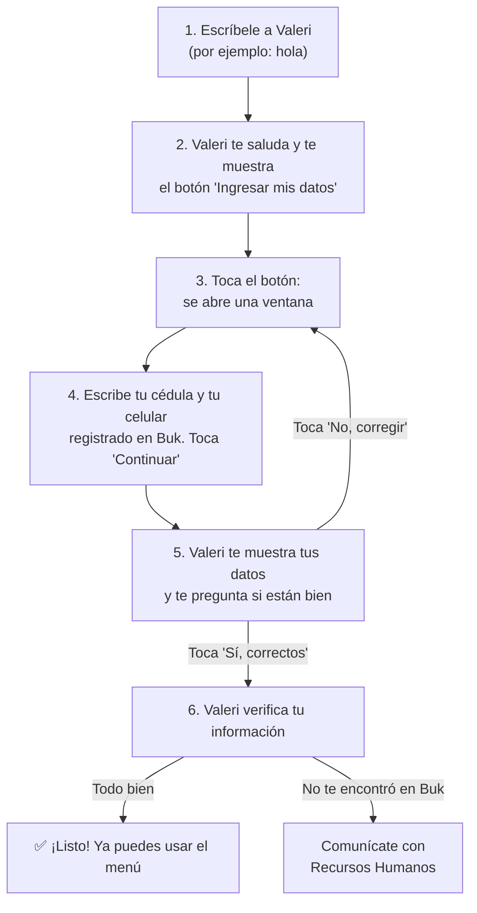
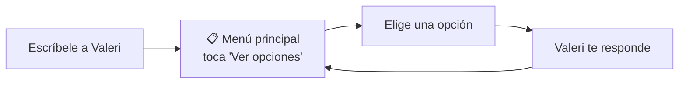
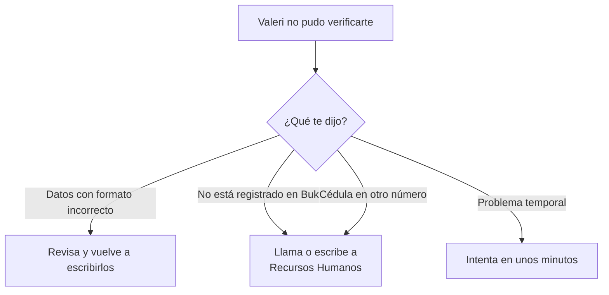

# Valeri — Guía de uso

Guía para conductores y personal administrativo de **Transportes Vigía**.
Última actualización: 2026-11-10.

---

## ¿Qué es Valeri?

Valeri es la asistente de Recursos Humanos de Transportes Vigía en **WhatsApp**.
Con ella puedes hacer trámites desde tu celular, sin entrar a la plataforma de Buk:

| Opción | Para qué sirve |
|---|---|
| 📄 Consultar extracto | Recibir tu comprobante de pago en PDF |
| 🌴 Días de vacaciones | Saber cuántos días de vacaciones tienes disponibles |
| 📝 Solicitar vacaciones | Pedir tus días de descanso |
| 📑 Certificado laboral | Recibir tu certificado laboral en PDF |
| 💬 Hablar con agente | Hablar con una persona de Recursos Humanos |

> Las opciones del menú se están habilitando poco a poco. Si una opción todavía no está
> disponible, Valeri te avisará.

**Número de Valeri:** +57 323 232 6150 (guárdalo en tus contactos como *Valeri*).

---

## Antes de empezar

Necesitas:

- Tu **número de cédula**.
- El **número de celular que tienes registrado en Buk** (el que diste a Recursos Humanos).
- WhatsApp en tu celular.

Valeri se maneja casi todo con **botones**: solo vas a escribir tu cédula y tu celular, y eso solo la primera vez.

---

## Primera vez: verificar tu identidad

Esto se hace **una sola vez**. Después Valeri te reconoce cada vez que le escribas desde ese mismo número.

### Paso a paso

1. **Escríbele a Valeri** cualquier mensaje, por ejemplo *hola*.
2. Valeri te responde con un saludo y un botón que dice **Ingresar mis datos**.
3. **Toca el botón.** Se abre una ventana dentro de WhatsApp.
4. En la ventana escribe:
   - **Número de cédula:** solo números, sin puntos. Ejemplo: `1023456789`.
   - **Celular en Buk:** el celular que tienes registrado en Buk. Ejemplo: `3001234567`.

   Luego toca **Continuar**.
5. Valeri te muestra tus datos y te pregunta: *¿Estás seguro de que estos son tus datos?*
   - Si están bien, toca **Sí, correctos**.
   - Si te equivocaste, toca **No, corregir** y la ventana se abre otra vez.
6. Valeri verifica tu información. Si todo está bien, te dice **✅ ¡Listo!** y te muestra el menú.

### Consejos

- Revisa bien los números antes de tocar **Sí, correctos**.
- Usa siempre el **mismo celular**: por seguridad, cada persona solo puede usar Valeri desde un número.
- Si escribes un mensaje en lugar de tocar un botón, Valeri te volverá a mostrar los botones.

---

## Uso diario: el menú

Cada vez que le escribas a Valeri (después de verificarte), te mostrará el **menú principal**:

1. Escríbele cualquier mensaje.
2. Toca **Ver opciones**.
3. Elige lo que necesitas de la lista.
4. Cuando termines, puedes volver a escribirle para ver el menú otra vez.

---

## Si algo sale mal

| Lo que te dice Valeri | Qué significa | Qué hacer |
|---|---|---|
| *"No pude reconocer esos datos"* | La cédula o el celular tienen un formato incorrecto (letras, muy cortos, etc.) | Vuelve a abrir la ventana y escríbelos solo con números |
| *"No pude verificar tu información en Buk"* | Tu cédula o tu celular no están registrados correctamente en Buk | Comunícate con **Recursos Humanos** para que revisen tus datos. Cuando estén corregidos, escríbele de nuevo a Valeri |
| *"Esta cédula ya está vinculada a otro número de WhatsApp"* | Ya te registraste antes desde otro celular | Si cambiaste de celular, comunícate con **Recursos Humanos** para actualizarlo |
| *"Tuve un problema para verificar tu información en este momento"* | Falla temporal del sistema, no es tu culpa | Intenta de nuevo en unos minutos |
| *"Esta opción estará disponible muy pronto"* | Esa opción del menú aún no está habilitada | Elige otra opción o vuelve más adelante |

---

## Preguntas frecuentes

**¿Tengo que verificarme cada vez?**
No. Solo la primera vez. Después Valeri te reconoce desde ese mismo número.

**¿Puedo usar Valeri desde otro celular?**
No directamente. Por seguridad, cada persona usa Valeri desde un solo número. Si cambiaste de celular, comunícate con Recursos Humanos.

**¿Mis datos están seguros?**
Valeri solo te pide tu cédula y tu celular para confirmar que eres tú. La información de pagos y vacaciones solo se envía al número verificado.

**¿Valeri tiene horario?**
Valeri responde en cualquier momento. La opción *Hablar con agente* dependerá del horario de Recursos Humanos.

**¿Qué hago si Valeri no me responde?**
Espera unos minutos y escríbele de nuevo. Si sigue sin responder, comunícate con Recursos Humanos.
