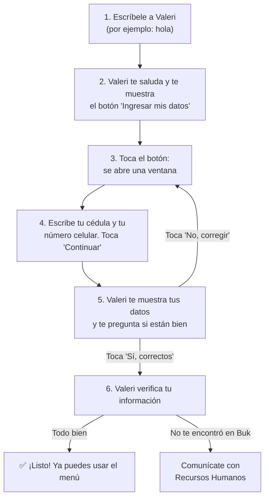
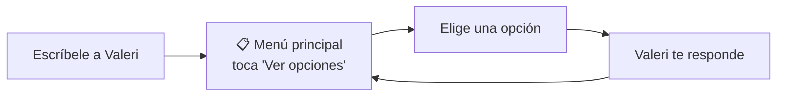
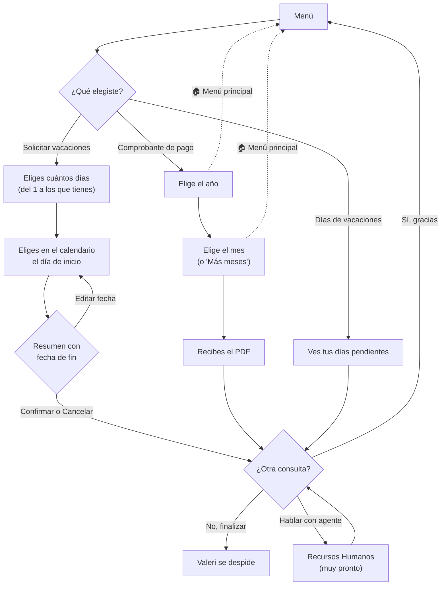
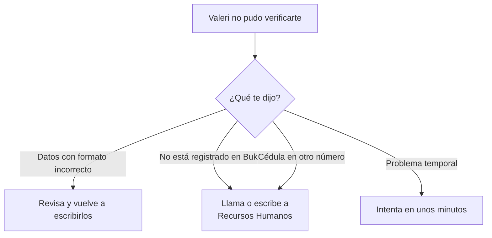

# Valeri — Guía de uso

Guía para conductores y personal administrativo de **Transportes Vigía**.
Última actualización: 2026-11-10.

---

## ¿Qué es Valeri?

Valeri es la asistente de Recursos Humanos de Transportes Vigía en **WhatsApp**.
Con ella puedes hacer trámites desde tu celular, sin entrar a la plataforma de Buk:

| Opción | Para qué sirve |
|---|---|
| 📄 Comprobante de pago | Recibir tu comprobante de nómina del mes que elijas, en PDF |
| 🌴 Días de vacaciones | Saber cuántos días de vacaciones tienes pendientes por disfrutar |
| 📝 Solicitar vacaciones | Pedir tus días de descanso |
| 📑 Certificado laboral | Recibir tu certificado laboral en PDF |
| 💬 Hablar con agente | Hablar con una persona de Recursos Humanos |

> Las opciones del menú se están habilitando poco a poco. Si una opción todavía no está
> disponible, Valeri te avisará.

**Número de Valeri:** +57 323 232 6150 (guárdalo en tus contactos como *Valeri*).

---

## Antes de empezar

Necesitas:

- Tu **número de cédula**.
- Tu **número celular** (el que diste a Recursos Humanos).
- WhatsApp en tu celular.

Valeri se maneja casi todo con **botones**: solo vas a escribir tu cédula y tu celular, y eso solo la primera vez.

---

## Primera vez: verificar tu identidad

Esto se hace **una sola vez**. Después Valeri te reconoce cada vez que le escribas desde ese mismo número.

### Paso a paso

1. **Escríbele a Valeri** cualquier mensaje, por ejemplo *hola*.
2. Valeri te responde con un saludo y un botón que dice **Ingresar mis datos**.
3. **Toca el botón.** Se abre una ventana dentro de WhatsApp.
4. En la ventana escribe:
   - **Número de cédula:** solo números, sin puntos. Ejemplo: `1023456789`.
   - **Número celular:** el celular que diste a Recursos Humanos, 10 dígitos. Ejemplo: `3001234567`.

   Luego toca **Continuar**.
5. Valeri te muestra tus datos y te pregunta: *¿Estás seguro de que estos son tus datos?*
   - Si están bien, toca **Sí, correctos**.
   - Si te equivocaste, toca **No, corregir** y la ventana se abre otra vez.
6. Valeri verifica tu información. Si todo está bien, te dice **✅ ¡Listo!** y te muestra el menú.

### Consejos

- Revisa bien los números antes de tocar **Sí, correctos**.
- Usa siempre el **mismo celular**: por seguridad, cada persona solo puede usar Valeri desde un número.
- Si escribes un mensaje en lugar de tocar un botón, Valeri te volverá a mostrar los botones.

---

## Uso diario: el menú

Cada vez que le escribas a Valeri (después de verificarte), te mostrará el **menú principal**:

1. Escríbele cualquier mensaje.
2. Toca **Ver opciones**.
3. Elige lo que necesitas de la lista.
4. Cuando termines, Valeri te vuelve a mostrar el menú por si necesitas algo más.

### 📄 Comprobante de pago

1. En el menú elige **Comprobante de pago**.
2. Toca **Ver años** y elige el año (por ejemplo *2026*).
3. Toca **Ver meses** y elige el mes.
   - Si no ves el mes que buscas, toca **Más meses ➡️** al final de la lista para ver los meses anteriores.
   - Para volver a los meses más recientes, toca **⬅️ Meses recientes**.

> 🏠 **¿Te equivocaste de opción?** Al final de cada lista (años y meses) está **🏠 Menú principal**. Tócalo y vuelves al menú de inicio sin consultar nada.
4. Valeri te dice *"Estoy buscando tu comprobante de pago"*. Puede tardar unos segundos.
5. Recibes tu comprobante como un **archivo PDF** dentro del chat. Tócalo para abrirlo o guardarlo.
6. Valeri te pregunta *"¿Deseas realizar otra consulta?"* con tres botones:
   - **Sí, gracias**: vuelves al menú principal.
   - **No, finalizar**: Valeri se despide y termina la conversación. Cuando le escribas de nuevo, verás el menú (no tienes que registrarte otra vez).
   - **Hablar con agente**: te comunica con Recursos Humanos *(muy pronto disponible)*.

Si ese mes todavía no tiene comprobante (por ejemplo, aún no se ha liquidado la nómina), Valeri te lo dirá. Puedes elegir otro mes.

### 🌴 Días de vacaciones

1. En el menú elige **Días de vacaciones**.
2. Valeri te dice cuántos días de vacaciones tienes **pendientes por disfrutar a la fecha de hoy**, por ejemplo: *Tienes 4 días de vacaciones pendientes por disfrutar*.
3. Luego te pregunta *"¿Deseas realizar otra consulta?"* con los mismos tres botones: **Sí, gracias**, **No, finalizar** y **Hablar con agente**.

### 🏖️ Solicitar vacaciones

1. En el menú elige **Solicitar vacaciones**.
2. Valeri revisa cuántos días tienes disponibles y te muestra una lista para elegir **cuántos días quieres pedir**. Solo verás los que puedes pedir: si tienes 4 días, la lista va del 1 al 4.
3. Toca **Ver días** y elige la cantidad.
   - Si tienes muchos días, al final de la lista está **Más días ➡️** para ver más cantidades, y **⬅️ Días anteriores** para volver.
4. Toca **Elegir fecha**: se abre un **calendario**. Toca el día en que empiezas tus vacaciones y luego **Continuar**.
   - Puedes elegir desde hoy hasta un año adelante.
   - Los **domingos y festivos aparecen bloqueados**, porque no son días hábiles.
   - Si tu WhatsApp no muestra el calendario, Valeri te pedirá la fecha con listas: primero el año, luego el mes y luego el día.
5. Valeri te muestra lo que vas a pedir: los **días hábiles** y la **fecha de inicio**. Todavía no se ha enviado nada.
6. Toca un botón:
   - **Confirmar**: se envía tu solicitud a Buk.
   - **Editar fecha**: eliges otra fecha de inicio (se mantienen los mismos días).
   - **Cancelar**: no se envía nada.
7. Si confirmaste, Valeri te dice *"¡Tu solicitud de vacaciones ha sido exitosa!"* y te muestra lo que **quedó registrado en Buk**: días hábiles, días calendario, cuándo inicias, cuándo terminas y cuándo regresas. Los domingos y festivos no se cuentan. Por ejemplo, 4 días desde el jueves 12 de noviembre de 2026 terminan el martes 17, porque el domingo 15 y el lunes 16 (festivo) no se cuentan.
   - Si Buk registró algo distinto a lo que pediste, Valeri te avisa.
   - Si Buk no acepta la solicitud, Valeri te dice el motivo y no se registra nada.

### 📑 Certificado laboral

1. En el menú elige **Certificado laboral**.
2. Valeri te dice *"Estoy generando tu certificado laboral"*. Puede tardar unos segundos.
3. Recibes tu certificado como un **archivo PDF** dentro del chat. Incluye tu nombre, cédula, cargo, fecha de ingreso y tipo de contrato (no incluye el salario).

Si en Buk faltan algunos de tus datos (por ejemplo, el cargo), Valeri te pedirá comunicarte con **Recursos Humanos** para que los completen.

> 💡 **Siempre igual:** cada vez que termina una consulta (comprobante, vacaciones o cualquier otra opción), Valeri te hace esta misma pregunta con los tres botones.

---

## Si algo sale mal

| Lo que te dice Valeri | Qué significa | Qué hacer |
|---|---|---|
| *"No pude reconocer esos datos"* | La cédula o el celular tienen un formato incorrecto (letras, muy cortos, etc.) | Vuelve a abrir la ventana y escríbelos solo con números |
| *"No pude verificar tu información en Buk"* | Tu cédula o tu celular no están registrados correctamente en Buk | Comunícate con **Recursos Humanos** para que revisen tus datos. Cuando estén corregidos, escríbele de nuevo a Valeri |
| *"Esta cédula ya está vinculada a otro número de WhatsApp"* | Ya te registraste antes desde otro celular | Si cambiaste de celular, comunícate con **Recursos Humanos** para actualizarlo |
| *"Tuve un problema para verificar tu información en este momento"* | Falla temporal del sistema, no es tu culpa | Intenta de nuevo en unos minutos |
| *"Esta opción estará disponible muy pronto"* | Esa opción del menú aún no está habilitada | Elige otra opción o vuelve más adelante |
| *"Tuve un problema para consultar tu información en este momento"* | Falla temporal al consultar Buk | Intenta de nuevo en unos minutos |
| *"No encontré tu comprobante de pago de…"* | Ese mes no tiene comprobante (puede no estar liquidado aún) | Prueba con otro mes o comunícate con **Recursos Humanos** |

---

## Preguntas frecuentes

**¿Tengo que verificarme cada vez?**
No. Solo la primera vez. Después Valeri te reconoce desde ese mismo número.

**¿Puedo usar Valeri desde otro celular?**
No directamente. Por seguridad, cada persona usa Valeri desde un solo número. Si cambiaste de celular, comunícate con Recursos Humanos.

**¿Mis datos están seguros?**
Valeri solo te pide tu cédula y tu celular para confirmar que eres tú. La información de pagos y vacaciones solo se envía al número verificado.

**¿Valeri tiene horario?**
Valeri responde en cualquier momento. La opción *Hablar con agente* dependerá del horario de Recursos Humanos.

**¿Qué hago si Valeri no me responde?**
Espera unos minutos y escríbele de nuevo. Si sigue sin responder, comunícate con Recursos Humanos.
